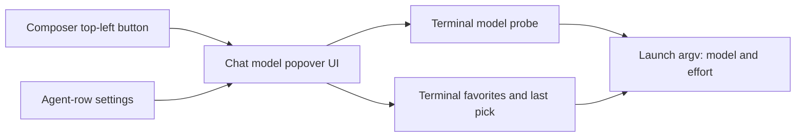

# PRD · APP-080: Terminal Agent Launch Probe

> Product Requirements · WHAT and WHY. Settled direction for picking a Terminal Agent model and effort level from the Agent Chat model popover, with Terminal-only storage.

## Context

- **Problem**: New Workspace and the Terminal Agent composer let people pick an agent, then ask them to type a model id and a thinking depth. Most of those fields have no choices. The CLIs already accept a model and an effort level, and Agent Chat already has a popover that lists models, effort, and favorites.
- **Why now**: The 2026-10-08 audit in [reference/cli-capability-audit.md](reference/cli-capability-audit.md) shows the manifest under-reports model catalogs and effort enums, and one row (`amp --effort`) names a flag the installed CLI does not have. Terminal Agents run in YOLO mode, so permission, plan, and fast are not the gap users asked to close.
- **Related specs**:
  - [APP-024](../APP-024_terminal-agent-run-config/PRD.md) owns the run-config concept (agent, model, reasoning, extra args). This spec replaces how model and reasoning are chosen. It does not replace saved templates or extra args.
  - [APP-072](../APP-072_automation-execute-modes/PRD.md) keeps Headless, Terminal, and Agent Chat on separate catalogs. This spec reuses Chat's popover component only.

### Forks settled from the brainstorm

- **Manifest plus live model probe**, not a `--help` scrape and not a static list typed by hand. The manifest says whether an agent has a model flag and how effort is passed. `terminal_agent_models_get` fills the model list and any per-model effort menu the CLI already returns.
- **Permission and fast stay out.** YOLO launch flags stay as they are. Fast model ids (Droid `*-fast`) stay rows in the model list.
- **Slash-only effort stays out.** Hermes `/reasoning` and `/fast`, and Claude `/effort ultracode` or `/effort auto`, are not launch controls.
- **Reuse the Chat model popover UI. Do not reuse Chat storage, Chat spawn, or the Chat agent catalog.**

## Goals

1. Primary: a person can choose a Terminal Agent model and effort level from real options, in the same popover Agent Chat uses, from the composer control and from the agent-row settings.
2. Secondary: favorites and the last model and effort for each Terminal Agent persist on their own, and never read or write Agent Chat favorites.

## Users & Scenarios

- **Primary persona**: Agentic Builder starting a workspace or sending a follow-up from the Terminal Agent composer.
- **Secondary persona**: someone who favorites models in Agent Chat and expects Terminal Agent favorites to be a separate list.

### Key scenarios

1. On New Workspace, the person clicks the agent button at the top-left of the composer and gets the Chat model popover: agent rail, model list, effort, favorites. They pick Codex and a listed model, set effort to high, and the first terminal session launches with that model and effort.
2. In the agent list, they open the row settings. Model and thinking depth are that same popover, not empty text fields.
3. They star a Grok model in the Terminal popover. Agent Chat's favorites list does not gain that row. Starring a model in Chat does not change the Terminal list.
4. They pick Claude Code. There is still no model catalog, so the model pane does not turn into a text box. Effort is a menu: low, medium, high, xhigh, max.

## User Stories

- As a Terminal Agent user, I want model and effort to be choices, so that I do not have to remember CLI ids.
- As a Terminal Agent user, I want the composer button and the row settings to open the same picker Chat already taught me.
- As someone who uses both Chat and Terminal, I want favorites kept apart, so that a TUI shortcut does not rearrange my Chat list.
- As a Claude Code user, I want an effort menu even when the CLI has no model list.
- As an Amp user, I want Atmos to stop offering an effort flag the CLI does not accept.

## Functional Requirements

### Must Have

- **M1 · Two entries, one popover**: The New Workspace composer agent button (the control anchored at the top-left of the composer) and the agent-row settings control both open the Agent Chat model popover component. The Terminal composer agent button and the Automations agent panel use that same component, because they are the same selector. The popover shows the agent rail, model search, effort submenu, favorites, and reload. It does not show Chat's fast chip, context chip, permission control, or mode control.

- **M2 · Options, not typed ids**: Built-in agents no longer use a free-text model field or a free-text thinking field.
  - An agent with a model catalog shows those models in the popover.
  - An agent with a closed launch effort list shows that list in the effort submenu.
  - When the selected model row carries its own effort list, that list replaces the agent-wide list.
  - An agent with no catalog shows the popover's empty model state and does not offer a text input. If that agent also has no list command, the pane does not offer a reload that would call nothing.
  - An agent with no launch effort hides the effort submenu.

- **M3 · Effort and model coverage for the audited CLIs**: The first ship shows choices only where the audit has a closed launch contract.

  | Agent                               | Model choices      | Effort choices                                                                             | Launch meaning                                |
  | ----------------------------------- | ------------------ | ------------------------------------------------------------------------------------------ | --------------------------------------------- |
  | Claude Code                         | none               | low, medium, high, xhigh, max                                                              | `--effort`                                    |
  | Codex                               | live catalog       | minimal, low, medium, high, xhigh                                                          | `--model` and config `model_reasoning_effort` |
  | Antigravity                         | live catalog       | low, medium, high, xhigh, max                                                              | `--model` and `--effort`                      |
  | Droid                               | live catalog       | the selected model's list from the catalog probe                                           | `--model` and `--reasoning-effort`            |
  | Grok Build                          | live catalog       | none, minimal, low, medium, high, xhigh, max, narrowed when the model row has its own list | `--model` and `--reasoning-effort`            |
  | Pi                                  | live catalog       | off, minimal, low, medium, high, xhigh, max                                                | `--model` and `--thinking`                    |
  | Command Code                        | live catalog       | low, medium, high                                                                          | `--model` and `--effort`                      |
  | Cursor Agent                        | live catalog       | effort submenu only when the selected model row carries an effort list                     | model id, with effort written into that id    |
  | OpenCode, Kilo Code                 | live catalog       | hidden                                                                                     | `--model` only                                |
  | Gemini, Amp                         | none               | hidden                                                                                     | Amp must not send `--effort`                  |
  | Devin, Kimi, Kiro, Hermes, OpenClaw | unchanged until N1 | unchanged until N1                                                                         | no guessed enums                              |

- **M4 · Terminal storage, isolated from Chat**: Favorites and the last model and effort for each Terminal Agent persist in a Terminal store. The record for a favorite is the agent id, the model id, and the label. Chat's `chat_prefs.json` is not read or written by this picker. A favorite selects the model. Effort stays the separate submenu value and is stored with the last Terminal pick for that agent.

- **M5 · Launch uses the Terminal run config**: Confirming a model, an effort, or extra args writes the existing Terminal run config and the launched argv. YOLO flags are unchanged. Saved run-config templates stay available. Editing the popover does not silently rewrite a saved template. Extra args stay a shell-style text field, parsed into `extra_args` as they are today. The field sits at the bottom of the effort popover (the one opened from the selected model's thinking chip). It is there for every Terminal agent, including one whose effort list is hidden. Agent Chat does not show the field. Custom agents keep extra args as the escape hatch for a flag Atmos does not understand. They do not gain a fake catalog.

- **M6 · Same Computer as the session**: Model lists and "installed" state come from the Atmos Computer the workspace is using, including a remote Computer.

- **M7 · Headless: disable the unsupported tab, not the picker**: On the headless surfaces that already refuse some agents, the new picker stays usable. Those surfaces are Automations when Execute Agent is Headless, and the settings control that picks the attention-summary agent. An agent with `automation_supported: false` is a disabled tab on the left rail. Hovering that tab shows the existing `unavailable_reason` (the same sentence the old row tooltip showed). The other tabs, the model list, effort, and favorites stay available. A disabled tab cannot become the selected agent, and a favorite of that agent cannot select it either. New Workspace, the Terminal composer, and Automations Terminal mode do not use this disable.

### Nice to Have

- **N1 · Docs-only agents**: After a local `--help` capture, add Devin's `models` command once its output format is known, Kimi's model list and on/off thinking, Kiro's model list and effort only if the binary prints the levels, Hermes model listing if a list command exists, and OpenClaw's documented model list and thinking levels. Do not ship those rows on the docs alone.
- **N2 · OpenCode and Kilo variants**: Show an effort submenu only if the model probe starts returning a closed variant list. Do not invent `high` / `max` / `minimal` as a fixed enum.

## Out of Scope

- **Permission modes, plan, ask, sandbox, and a fast toggle** — Terminal Agents stay on the current YOLO flags. Fast is not a separate control.
- **Agent Chat sessions** — the popover is shared UI. Spawn, prefs, and the Chat agent list stay on the Chat path.
- **Slash commands after the TUI is up** — Hermes reasoning and fast, and Claude `ultracode` / `auto`, are session commands, not this picker.
- **Welcome advanced options** — workspace name, branch, base branch, GitHub, and Linear stay where they are.
- **Typing a model id for a built-in** — removed on purpose. Extra args on a custom agent remain the unsupported-CLI path.
- **Mobile** — web and desktop clients of the Computer only.

## Success Metrics

- Leading: for every agent in the M3 table that has a model catalog or an effort list, the popover shows those choices and the launched command contains the matching model and effort arguments.
- Leading: starring a model in Terminal changes only the Terminal favorite list.
- Qualitative: a person who already uses the Chat model popover can pick a Terminal model and effort without learning a second form.

## Risks & Open Questions

- **Risk**: Claude and Gemini users who typed a model id lose that text field. The replacement is an empty model pane plus, for Claude, an effort menu. Extra args on a custom agent are the remaining typed path.
- **Risk**: Command Code's help says "e.g. low, medium, high" and that the set depends on the model. The picker offers only those three words so it does not invent `max`.
- **Risk**: Cursor effort is inside the model id. A separate effort submenu appears only when the probe attaches an effort list to that model. Otherwise Cursor is model-only.
- **Resolved**: the agent-row settings popover locks the agent rail to the row that was opened. The composer button keeps the rail so the person can change agent, model, and effort in one place. Headless unsupported agents are disabled tabs with a hover reason (M7), not a disabled picker.

## Milestones

- Phase 1 — M1, M2, M4, M5, M6, M7, and the agents in M3 whose catalog or enum already exists (Claude effort, Codex, Pi, Grok, Droid, OpenCode, Kilo, Command Code, Cursor, Antigravity).
- Phase 2 — N1 and N2 as each CLI's list or effort contract is captured locally.
