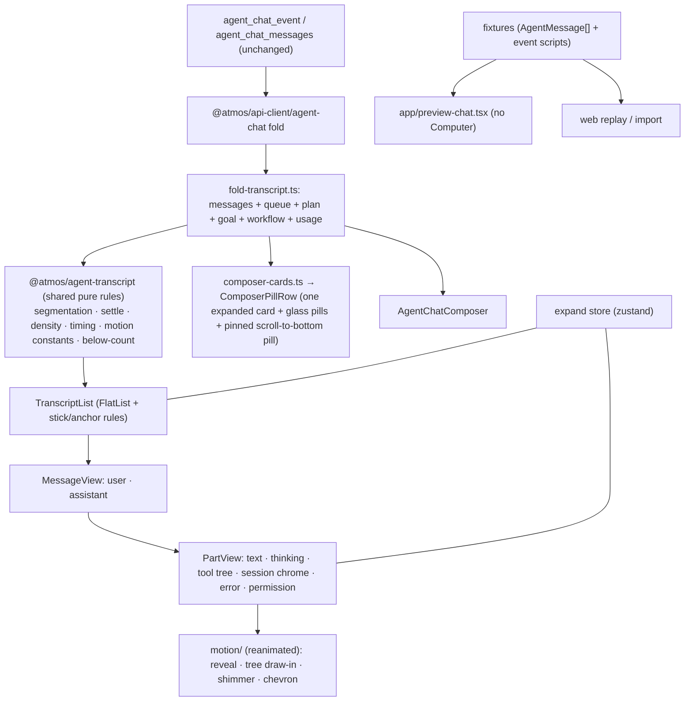

# TECH · APP-081: Mobile Agent Chat Web Parity

> Technical Design · HOW. Implements PRD APP-081 (M1–M9). Gap ids `G-nn` are defined in [BRAINSTORM](./BRAINSTORM.md). Baseline architecture is [APP-079 TECH](../APP-079_mobile-agent-chat/TECH.md); this file only records what changes.

## Scope summary

Replace the phone's sheet-based transcript with a web-equivalent rendering model, add the card lane and composer parity, and prove it with fixtures and real simulator evidence.

- Touched: `apps/mobile/src/features/agent-chat/**`, `apps/mobile/app/**` (one dev preview route), `packages/agent-transcript` (shared pure logic and fixtures), `.github/workflows/` (new iOS parity workflow), `scripts/agent-chat-parity/` (comparison tooling), `apps/mobile/AGENTS.md`.
- `apps/web`: **import-path swaps only**, and only if decision D2(a) is approved. No behavior change.
- No new `WsAction`, no REST, no `crates/` change, no new persisted data.
- Supersedes APP-079 transcript display decisions: tool/thinking detail in `ExpoDrawer` sheets, "mermaid is a fence" stays, "duplicate the tool-kind table" is replaced by D2.

## Architecture overview



## Decisions

- **D1 — Inline tree replaces sheets for transcript detail (G-04…G-07, G-11).** Tool groups, process fold, thinking, and subagent wait expand in place with web's tree. `AgentChatDetailSheet` and `event-model.ts` sheet frames are deleted (no compatibility needed). `ExpoDrawer` stays only for the Messages sheet and composer sheets.
- **D2 — Shared pure logic lives in `@atmos/agent-transcript` (G-29). Approved: (a), 2026-10-15.**
  - Move these pure modules into the package: `lib/tool-group.ts`, `lib/assistant-process-parts.ts`, `lib/tool-call-density.ts`, `lib/agent-tree-branch.ts`, `lib/agent-chat-timing.ts`, `lib/agent-chat-below-count.ts`, `lib/agent-chat-commit-buffer.ts` (G-15; pure, depends only on `@atmos/api-types`), and the pure helpers in `lib/agent-chat-transcript-window.ts`. Also move `isHiddenGrokChromePart` and the pure callees it needs out of `lib/grok-chrome.ts` (it is imported by `tool-group` / `assistant-process-parts`). Move `USER_MESSAGE_COLLAPSE_LINES` and `USER_MESSAGE_COLLAPSE_FADE_LINES` out of `apps/web/src/shared/lib/composer-paste.ts` (the rest of that file stays; it is paste/DOM).
  - **Do not move DOM.** `findAgentChatScrollElement` and `measureTranscriptScrollMargin` use `ParentNode`, `HTMLElement`, and `getBoundingClientRect`. They stay in the web file. The package `tsconfig` lib is `ES2022` with `types: ["node"]` and has no DOM lib. `isTranscriptScrolledToEnd` moves only with a structural argument `{ scrollHeight, scrollTop, clientHeight }`.
  - Web files at the old paths become re-exports (plus the DOM leftovers in the transcript-window file). Feature call sites do not change. That is the allowed import-path edit: one source of truth, no behavior diff. Existing web tests keep importing the old paths.
  - Delete `apps/mobile/.../assistant-process.ts` and any mobile timing copies. Mobile imports the package.
  - (b) is not used.
  - The package stays UI-free and depends only on `@atmos/api-types`.
- **D3 — Expand store (G-21).** `apps/mobile/src/features/agent-chat/expand-store.ts`, zustand, same key builders as web (`agentChatProcessExpandKey`, `agentChatToolGroupExpandKey`, `agentChatInspectExpandKey`, `agentChatUserBodyExpandKey`, `agentChatUserMetaExpandKey`). If D2(a), the key builders move to the shared package; the store itself stays per-app. Reset only when the active chat id changes.
- **D4 — List engine (G-17…G-20).** Keep `FlatList` (virtualized, no new dependency). Behavior is rule-driven:
  - Stick: while `stickToEnd` is true, scroll to end on content-size change; `stickToEnd` flips false on user drag away from the end (threshold = web `TRANSCRIPT_END_SLACK_PX` 24 rather than the current 64) and true again on reaching the end or tapping scroll-to-bottom.
  - No jump while reading up: `maintainVisibleContentPosition` on the list so a row that resizes above the viewport does not move the reading line (the RN analogue of web's `shouldAdjustTranscriptScrollOnItemSizeChange`). **Spike in S5**: if it misbehaves with streaming rows on iOS, fall back to compensating `scrollToOffset` using the shared rule.
  - Gap 12 (from shared constant), horizontal padding per token map, stable keys from `stableAgentMessageKey`.
  - Own-send: sending a message inserts a pending echo (dim 0.65) that is replaced by the server row with the same key; list anchors the sent row instead of jumping (G-20).
  - Activity indicator renders as the footer of the last row, not as a sibling list item (G-14).
- **D5 — Motion on `react-native-reanimated` 4 (already a dependency).** One `motion/` folder: `StreamReveal`, `TreeBranch`, `Shimmer`, `Chevron`, `SlidingNumber` (reuse `number-flow-react-native` already in `package.json`), all gated by one `useReducedMotion()` (reanimated). Constants come from the shared package (D2) so they cannot drift. **Shimmer is a real gradient sweep** (Q4 approved): `expo-linear-gradient` masked to the glyphs with `@react-native-masked-view/masked-view`, same idea as web `TextShimmer` (`background-clip: text`). Durations match the web call sites, not the component default of 2s: thinking and running tool-group titles `1`, activity indicator `1.5`. See Motion mapping below.
- **D6 — Card lane is a pure reducer plus a view (G-23…G-25).** `card-lane.ts` (pure, unit-tested) decides which card is visible; `ComposerPillRow.tsx` renders the pill row and the expanded card, with `ScrollToBottomPill.tsx` pinned in the row (D10). Card descriptors come from `composer-cards.ts`, derived from the same state web derives from (`use-agent-chat-session.ts`: `currentPlan`, `runningBackgroundTools`, `subagentTasks`, `grokGoal`, `grokWorkflow`, `sessionUsage`, `queuedPrompts`, `pendingPermission`, `pendingSessionOp`). `fold-transcript.ts` is extended to fold the missing events (goal, workflow, usage, available commands already folded); S6 lists the exact event types by reading the web hook before coding.
- **D7 — Fixtures are shared, committed, and sanitized.** `packages/agent-transcript/fixtures/parity/*.json`: `{ id, title, messages: AgentMessage[], cards, script?: ChatEventScript }`. `script` is an ordered list of `{ atMs, event: AgentChatEvent }` replayed through the real fold on both sides to exercise streaming and animation. Fixtures are captured from a real chat via `agent_chat_get` + `agent_chat_messages` and scrubbed (no paths with usernames, no tokens, no private repo content).
- **D8 — Phone preview route.** `apps/mobile/app/preview-chat.tsx` (precedent: `app/preview.tsx` mock terminal, no Computer). Query params: `fixture`, `theme` (`light` / `dark`), `replay` (0/1), `expand` (`none` / `process` / `all`). Renders the real transcript + card lane + composer shell from a fixture without a WebSocket. Enabled in all builds that are not App Store release builds (guard on an `EXPO_PUBLIC_PARITY_PREVIEW` flag set only by the CI workflow and local dev); the route renders nothing otherwise.
- **D9 — Copy parity.** `copy.ts` strings that mirror `apps/web/messages/en.json` keys (`Agent.components.chatPanel.*`, `Agent.components.assistantTurn.*`, `Agent.components.chatPanel.session.*`, `scrollBelow.*`) are asserted equal by a Bun test that reads the JSON file (file read, not a package import).
- **D10 — Scroll-to-bottom lives in the card pill row (G-19, G-25).** AruNi: the row above the input is a horizontally scrollable list of glass buttons; tapping one expands its card, one at a time; the scroll-to-bottom button joins this row and sits at the far left. The pinned pill is outside the scroller; its visibility derives from the list's `stickToEnd` state (D4) and the shared below-count rule. It replaces web's floating, centered `AgentChatScrollToBottomButton`.

## Gap → design map

| Gap                    | Design                                                                                                                                                                                                                                                                                                                                                                              | Slice  |
| ---------------------- | ----------------------------------------------------------------------------------------------------------------------------------------------------------------------------------------------------------------------------------------------------------------------------------------------------------------------------------------------------------------------------------- | ------ |
| G-01, G-02             | `UserMessage.tsx` (bubble, meta row, collapse, chips, pending echo); `AssistantFooter.tsx` (copy, usage, worked-for ↔ clock via tap, file-changes summary)                                                                                                                                                                                                                          | S2     |
| G-03, G-04             | `AnswerText.tsx` (markdown with caret and file chips), `ThinkingBlock.tsx` (shimmer title, inline body)                                                                                                                                                                                                                                                                             | S2     |
| G-05, G-06, G-11       | `ToolGroup.tsx` + `TreeBranch.tsx` + `tool-bodies/` (`CommandOutput`, `DiffResult`, `CodePreview`, `PathPreview`, `WebSearch`, `ImageOutput`, `PlanDocument`, `SubagentCard`, `GenericTool`)                                                                                                                                                                                        | S3     |
| G-07                   | `ProcessFold.tsx` using shared `shouldCollapseAssistantProcess`, `hasCollapsibleAssistantProcess`, `shouldAutoCollapseProcessOnSettle`; density plumbing with default `compact`                                                                                                                                                                                                     | S3     |
| G-08, G-09, G-10       | `SessionChrome.tsx`, `ErrorPart.tsx`, `HistoricPermission.tsx` reusing the permission card in read-only mode                                                                                                                                                                                                                                                                        | S2     |
| G-12, G-13, G-14, G-16 | `motion/*`, `ActivityIndicator.tsx`                                                                                                                                                                                                                                                                                                                                                 | S4     |
| G-15                   | `use-smooth-stream.ts`: same 56 ms commit buffer and flush rules as web `agent-chat-commit-buffer.ts` / `useSmoothStreamText` (port or share per D2). The web hook `useSmoothStreamText` lives in `packages/ui/src/components/ai-elements/smooth-stream-text.ts`; it is React-only (no DOM imports in its header), but verify before importing it from the phone, otherwise port it | S4     |
| G-17…G-20, G-22        | `TranscriptList.tsx`, `ScrollToBottomPill.tsx` (lives in the pill row, D10), `EdgeFades.tsx` (`expo-glass-effect` is not used; plain gradient views or `GlassPanel` tint, see Motion mapping), own-send runtime                                                                                                                                                                     | S5     |
| G-21                   | `expand-store.ts` (D3)                                                                                                                                                                                                                                                                                                                                                              | S2     |
| G-23…G-25              | `card-lane.ts`, `ComposerPillRow.tsx`, `cards/*`                                                                                                                                                                                                                                                                                                                                    | S6     |
| G-26, G-28             | `AgentChatComposer` additions: context-usage trigger and card, paste chips, attachment header chips, queue edit                                                                                                                                                                                                                                                                     | S7     |
| G-27                   | Optional N1 landing motion                                                                                                                                                                                                                                                                                                                                                          | S7     |
| G-29, G-30             | D2, token map, D9                                                                                                                                                                                                                                                                                                                                                                   | S0     |
| G-31                   | D7, D8, TEST                                                                                                                                                                                                                                                                                                                                                                        | S1, S8 |

## Card lane and pill row

Layout above the composer (top to bottom), inside the footer of `ChatKeyboardFrame`:

```
[ expanded card ]            0 or 1, cardElevated + glassBorder + radius 16, fade 180 ms
[ ◀pinned▶ | scrollable → ]  pill row; left: scroll-to-bottom pill; right: card pills
[ composer ]                 existing AgentChatComposer
```

The expanded card renders **above** the pill row so the row, and the pill under the user's finger, never move when a card opens or closes (**confirmed by AruNi, 2026-10-15**). The row sits directly on top of the composer.

Card ids and pill titles. A pill shows **only** this title (no icon, no count badge). Titles are the strings the web card already renders:

| Id           | Pill title                                                                                                                                                                                                                                                                                                           |
| ------------ | -------------------------------------------------------------------------------------------------------------------------------------------------------------------------------------------------------------------------------------------------------------------------------------------------------------------- |
| `permission` | Same branch as `AgentPermissionCard`: questions → `chatPanel.askUserTitle` ("Questions for you"); plan exit → `chatPanel.planApprovalTitle` ("Plan ready"); otherwise `chatPanel.permissionRequested` ("Permission requested"). Not `Agent.chat.permissionTitle` ("Permission needed"), which is a different string. |
| `session_op` | `chatPanel.sessionOpRequested` ("Session action requested"). The request's own heading stays inside the card.                                                                                                                                                                                                        |
| `plan`       | `Agent.components.plan.title` ("Plan")                                                                                                                                                                                                                                                                               |
| `background` | `backgroundCommands.title` ("Background")                                                                                                                                                                                                                                                                            |
| `queue`      | `messageQueue.title` ("Message Queue")                                                                                                                                                                                                                                                                               |
| `subagents`  | `subagentTasks.title` ("Subagent Tasks")                                                                                                                                                                                                                                                                             |
| `goal`       | `grok_goal.objective` trimmed, else `grokGoal.title` ("Goal")                                                                                                                                                                                                                                                        |
| `workflow`   | `grok_workflow.objective` or `name` trimmed, else `grokWorkflow.title` ("Research"). The fallback is not the word "Workflow".                                                                                                                                                                                        |
| `context`    | `contextWindow.title` ("Context Usage")                                                                                                                                                                                                                                                                              |

```ts
type CardId =
  | "permission"
  | "session_op"
  | "plan"
  | "background"
  | "queue"
  | "subagents"
  | "goal"
  | "workflow"
  | "context";
type LaneState = { visible: CardId | null; userChoice: CardId | null };
// Pure. `available` is the set of cards that currently have content.
function reduceLane(
  state: LaneState,
  action:
    | { type: "available_changed"; available: readonly CardId[]; arrived: readonly CardId[] }
    | { type: "pill_tapped"; id: CardId }
    | { type: "card_dismissed"; id: CardId },
): LaneState;
```

Rules (unit-tested in `card-lane.test.ts`):

1. `visible` is always `null` or a member of `available`.
2. A newly arrived `permission` or `session_op` sets `visible` to that id immediately (it blocks the agent) and does **not** change `userChoice`. Other arrivals never steal the slot. "Arrived" is edge-triggered (`arrived`), not "still in `available`", so collapsing a pending approval does not immediately reopen it.
3. `pill_tapped(id)` toggles. If `id` is not visible: `visible = id` and `userChoice = id`. If `id` is already visible: `visible = null`, and `userChoice` becomes `null` only when `id === userChoice`. Collapsing an auto-preempted card keeps `userChoice`.
4. When a card leaves `available` and that card is the current `visible`, `visible` becomes `userChoice` if `userChoice` is still available and is not the card that just left, else `null`. A card that was not visible leaving `available` does not change `visible`. This is what puts the user's last card back when they answer a preempting permission (TEST S17).
5. On first load with no approval pending, `visible` is `null` and every available card has a pill. (Default-collapsed keeps the transcript readable on a phone; revisit after AruNi sees the first build.)
6. Pill order is a fixed priority: `permission`, `session_op`, `plan`, `queue`, `background`, `subagents`, `goal`, `workflow`, `context`.
7. The reducer knows nothing about scroll-to-bottom. That pill is not a card (D10).
8. A pending `permission` / `session_op` pill that is collapsed shows an attention dot; the agent stays blocked until it is answered.

### Pill row view (`ComposerPillRow.tsx`)

- Structure: `View` (row, `alignItems: center`, `gap: 8`, horizontal padding 18 to match the transcript) containing, left to right: `ScrollToBottomPill` (fixed, **outside** the scroller) then a horizontal `ScrollView` (`showsHorizontalScrollIndicator={false}`, `keyboardShouldPersistTaps="handled"`, content gap 8, `contentContainerStyle` right padding 18) holding the card pills.
- Pill: `GlassPanel interactive` capsule, **title text only** (`numberOfLines={1}`, truncates, max width ~60 % of the screen). No leading icon and no count badge; counts stay inside the expanded card, as on the web card body/header. Provisional height 36 (composer `BUTTON_SIZE`) and horizontal padding 14 — **pixel metrics are unverified until 图一 exists**. Expanded (active) pill uses a stronger `tintColor` (`controlGlassTint` → `glassTint`) plus `accessibilityState={{ selected: true }}`.
- When the card pills overflow, a short right-edge fade hints that the row scrolls; it never covers the pinned pill.
- The row is not rendered when it would be empty (no cards and the scroll pill hidden). Its height, plus the expanded card's height, feeds the transcript bottom pad (below).
- Accessibility: the pill is a button named by its title; the scroll pill uses web's `scrollBelow.aria` (when N > 0) or `bottom` (N = 0) strings (D9).

### Scroll-to-bottom pill (`ScrollToBottomPill.tsx`, D10)

- Position: leftmost item of the row, fixed. Card pills scroll to its right and never pass under it.
- Visibility: rendered when `messages.length > 0` **and** the list is not at its end, i.e. `stickToEnd === false` (distance from end > `TRANSCRIPT_END_SLACK_PX` = 24, the same threshold as stick, D4). Hidden at the end, including during streaming while stuck. Fade 180 ms; the card pills slide left/right by animating the pinned slot width over the same 180 ms (instant under Reduced Motion).
- Content: chevron-down. When the below-count `N > 0` (shared `countMessagesBelowViewport` rule) the label is composed exactly as web's `AgentChatScrollBelowCopy`: `prefix` + number + pluralized `unit` + `suffix` from `Agent.components.chatPanel.scrollBelow`, which renders as "3 messages below" (this spec writes "N below" as shorthand); the number uses `number-flow-react-native`; at `N = 0` but not at the end (a long single message) it is the chevron alone.
- Action: animated scroll to the end, set `stickToEnd = true`. It never expands or collapses a card and is not affected by the card choice.
- Not a card: excluded from `LaneState`, from "at most one card", and from the card pill order.
- No separate floating overlay exists on the phone; the web `data-agent-chat-scroll-button-host` has no counterpart.

### Card chrome

Card chrome is unchanged from today's `cardElevated` + `glassBorder` + radius 16. Enter/exit is a 180 ms opacity fade (reanimated), same easing as web `EASE_OUT`; no slide, no scale. Card max height is a fraction of the available column so the transcript stays reachable; card body scrolls. Transcript bottom padding = base 40 + (expanded card height + pill row height), easing 350 ms when it shrinks (G-18), measured via `onLayout`.

<!-- updated 2026-10-18: composer-adjacent lane chrome uses GlassPanel -->

**Implementation delta (2026-10-18):** Title pills, the pinned scroll-to-bottom pill, and the expanded card shell now use the same `GlassPanel` as the composer wells (`expo-glass-effect` `GlassView` on iOS 26). Fallback fill is `glassFallback` / `glassFallbackStrong` when Liquid Glass is unavailable, the effect API is missing, or Reduce Transparency is on. Lane interaction (one expanded card, re-tap to collapse, pill order, 180 ms fade) is unchanged. Inner card actions stay filled `control` chips so they stay distinct on the glass shell. Transcript historic permission cards stay `cardElevated`.

## Motion mapping

All durations and easings come from `agent-tree-branch.ts` constants (shared per D2). Reduced Motion: every row below becomes an immediate state change.

| Web effect (source)                                                                                | Phone implementation                                                                                                                                                         | Fidelity |
| -------------------------------------------------------------------------------------------------- | ---------------------------------------------------------------------------------------------------------------------------------------------------------------------------- | -------- |
| Part reveal: rows 0fr→1fr, opacity, `blur(6px)`, lift 4 px, mask fade 22 px, 400 ms                | reanimated: animated height (measured), opacity, `translateY(4)`; same 400 ms and `cubic-bezier(0.23,1,0.32,1)`. **No blur and no mask** (see Deviation register)            | partial  |
| Tree draw-in: stroke-dash 400 ms, stagger 40 / 56 / cap 560, content delay 70                      | `react-native-svg` `Path`/`Line` with animated `strokeDashoffset` (`useAnimatedProps`), explicit dash length from geometry (elbow arc + arm; trunk = measured row height)    | full     |
| Title letter stagger (15 ms/char, 300 ms segment)                                                  | per-character opacity with the same stagger; capped by the shared `treeTitleRevealMs`                                                                                        | full     |
| Chevron rotate 90°, 200 ms                                                                         | reanimated rotate                                                                                                                                                            | full     |
| `TextShimmer` (call-site duration: thinking/tool title 1 s, activity 1.5 s; linear ease, infinite) | `expo-linear-gradient` swept across the glyphs through `@react-native-masked-view/masked-view`. Same durations. Reduced Motion: static base color                            | full     |
| Worked-for ↔ clock swap 200 ms (hover)                                                             | cross-fade 200 ms on tap                                                                                                                                                     | full     |
| Overlay card fade 180 ms                                                                           | reanimated opacity 180 ms                                                                                                                                                    | full     |
| `SlidingNumber`, `TextMorph` (below count, clock)                                                  | `number-flow-react-native` for numbers; text morph → cross-fade                                                                                                              | partial  |
| Pad shrink 350 ms `cubic-bezier(0.22,1,0.36,1)`                                                    | reanimated height                                                                                                                                                            | full     |
| Block caret while a text part is open                                                              | trailing `▍` glyph inside the markdown renderer's last text run if the renderer exposes it; otherwise an absolutely positioned blinking block after the last line (S2 spike) | partial  |

## Deviation register (must be copied into the PR description)

| Id  | Deviation                                                                                                                    | Reason                                                     | Fallback                                      |
| --- | ---------------------------------------------------------------------------------------------------------------------------- | ---------------------------------------------------------- | --------------------------------------------- |
| V1  | No CSS blur or mask in part reveal                                                                                           | RN has no iOS blur filter or mask-image on arbitrary views | opacity + translate + height                  |
| V2  | Removed. Real glyph shimmer ships (`expo-linear-gradient` + `@react-native-masked-view/masked-view`, both listed in the PR). | Q4 approved 2026-10-15                                     | —                                             |
| V3  | Hover swaps and hover rail become tap/long-press                                                                             | No pointer                                                 | tap toggles meta; header Messages sheet stays |
| V4  | File paths are non-navigating chips                                                                                          | APP-079 M6 (no editor/file tree on phone)                  | chip look, no action                          |
| V5  | Composer keeps native glass controls                                                                                         | `agents/references/design/mobile.md`                       | filled input, glass buttons                   |
| V6  | One card expanded; others are glass pills in a scrollable row; scroll-to-bottom is the pinned left pill                      | AruNi's mobile exception and layout                        | pill row above the input                      |
| V7  | Fonts are system fonts                                                                                                       | iOS/Android platform fonts                                 | match size scale and weight, not family       |
| V8  | Session-op card has no web `ShineBorder`                                                                                     | Phone cards keep `cardElevated` + hairline `glassBorder`   | existing card chrome                          |
| V9  | Queue reorder is up/down buttons, not pointer drag                                                                           | No drag-and-drop library on the phone                      | same remove / edit / move actions as web      |

## Token map

Documented and tested (G-30). Values stay owned by their theme; this table fixes which role maps to which.

| Web role (Tailwind token)              | Phone role (`useMobileTheme().colors`)                                                                    | Use                              |
| -------------------------------------- | --------------------------------------------------------------------------------------------------------- | -------------------------------- |
| `text-foreground`                      | `label`                                                                                                   | answer text, user text           |
| `text-muted-foreground`                | `secondaryLabel`                                                                                          | group rows, thinking, worked-for |
| `bg-secondary` (user bubble)           | `cardSubtle` on `background` (verify contrast in both schemes; replaces hard-coded `#242424` / `#f2f1ef`) | user bubble                      |
| `border` / `bg-foreground/[0.04]`      | `glassBorder` / `cardSubtle`                                                                              | rails, card chrome, code blocks  |
| `text-destructive`, `bg-destructive/5` | `red`, `redSurface`, `redBorder`                                                                          | error part, failed lifecycle     |
| amber tone (hint warning)              | `yellow`                                                                                                  | session hint                     |
| `text-sm` / `text-xs`                  | 14 px / 20 line and 12 px / 16 line                                                                       | text sizes                       |

## Data model

No persisted data. Runtime additions only:

```ts
type ExpandKey = string; // same key builders as web
type ExpandStore = {
  values: Record<ExpandKey, boolean>;
  setExpand(k: ExpandKey, v: boolean): void;
  reset(): void;
};
type ParityFixture = {
  id: string;
  title: string;
  messages: AgentMessage[];
  cards?: Partial<Record<CardId, unknown>>;
  script?: Array<{ atMs: number; event: AgentChatEvent }>;
};
```

## Transport

Unchanged (`agent_chat_*` via existing wrappers; `agent_chat_event` notifications). Confirmed on the current wire in `@atmos/api-types` (`agent-chat.ts`): `plan_updated`, `usage_updated`, `queue_updated` (mobile fold already applies this), `grok_goal_updated`, `grok_workflow_updated`, plus snapshot fields `session_usage`, `grok_goal`, `grok_workflow`. Extend `fold-transcript.ts` to retain plan, usage, goal, and workflow. Do not add a `WsAction`. The web permission card may `fetch` a plan file over Computer HTTP; the phone shows plan markdown already present on the permission or in the transcript and does not add that HTTP client. Missing file text uses the same empty copy as web (`planViewerEmpty`).

## Verification tooling (summary; contract in TEST.md)

- `scripts/agent-chat-parity/`: fixture loader, web capture (Playwright), structural comparer, and the Cursor-agent-CLI rubric runner. Lives outside `apps/web` so Next builds never see it (same rule as `scripts/agent-chat-stream-perf/`).
- `.github/workflows/ci-mobile-ios-parity.yml`: macOS runner build, simulator boot, fixture screenshots and recordings, artifact upload. Details and version pins in TEST.md.
- mobai-dev Linux preview: inner-loop only, see TEST.md "mobai-dev evaluation".

## Security & permissions

- The preview route and fixtures contain no Computer access and no credentials. Fixtures are scrubbed before commit (D7). The route is inert unless `EXPO_PUBLIC_PARITY_PREVIEW` is set.
- The workflow uses default `GITHUB_TOKEN` read permissions plus `actions: write` only for artifact upload (implicit). No secrets. Artifacts contain only fixture renders.
- No additional logging of prompts or tool output (APP-079 rule stands).

## Rollout plan (slices)

Each slice typechecks (`bun --filter @atmos/mobile typecheck`) and runs `cd apps/mobile && bun test`; web-affecting slices also run the web unit tests that moved with the code.

| Slice | Content                                                                                                                                                                        | Depends        |
| ----- | ------------------------------------------------------------------------------------------------------------------------------------------------------------------------------ | -------------- |
| S0    | Shared pure logic (D2), token map, copy parity test, delete mobile duplicates                                                                                                  | specs approved |
| S1    | Fixtures (D7), phone preview route (D8), web capture harness spike, structural comparer, mobai-dev spike                                                                       | S0             |
| S2    | Expand store, user/assistant messages, answer text, session chrome, error, historic permission                                                                                 | S0, S1         |
| S3    | Tool group tree, tool bodies, process fold, density                                                                                                                            | S2             |
| S4    | Motion, activity indicator, stream pacing                                                                                                                                      | S3             |
| S5    | List stick/anchor rules, scroll-to-bottom state, `ComposerPillRow` shell hosting the pinned scroll pill (row holds no card pills yet), edge fades, own-send, bottom pad        | S2             |
| S6    | Card lane, card pills in the S5 row, card derivation, card contents (permission questions/todos/plan intent, queue edit, plan, background, subagents, goal, workflow, context) | S2, S5         |
| S7    | Composer parity items, optional landing motion                                                                                                                                 | S6             |
| S8    | macOS iOS parity workflow, artifacts, evidence report, `TEST.md` Coverage Status                                                                                               | S1–S7          |

## Risks & tradeoffs

- **Risk**: `maintainVisibleContentPosition` plus streaming rows may jitter. Mitigation: S5 spike with a recorded fixture; fallback to shared-rule offset compensation.
- **Risk**: Inline tree for long command output hurts list performance. Mitigation: command output keeps web's collapse (line cap + expand), lazy-mounted bodies, row `React.memo`.
- **Risk**: Markdown renderer (`react-native-streamdown` / `enriched-markdown`) cannot match streamdown for tables, code highlight, or mermaid. Mitigation: parity fixture F1 documents what differs; fallback is a custom renderer slice, decided with AruNi after S2 screenshots.
- **Risk**: Shimmer/blur look weaker than web. Mitigation: deviation register, honest recordings.
- **Risk**: Web import-path swaps (D2a) conflict with parallel web work. Mitigation: do S0 first, as its own commit set, rebase early.
- **Tradeoff**: Collapsed-by-default card lane hides cards on first load. Chosen to protect transcript space; one-line change if rejected.
- **Rollback**: revert the PR; server data untouched. The previous phone transcript is not preserved (no compatibility requirement).

## Dependencies & compatibility

- Depends on APP-067/068/069 wire, QUALITY-006/008 behavior, APP-079 screens, APP-077 connection.
- New dependencies (Q4 approved): `expo-linear-gradient` and `@react-native-masked-view/masked-view`, license-checked before `bun add` (expect MIT; no `NOTICE` entry for registry packages). List both in the PR description.
- Minimum server: whatever already serves web.
- No backward compatibility with the previous phone transcript, sheets, or `event-model.ts` view models.

## Open questions

- **Q1 — still open**: pixel metrics of 图一 (height, spacing, active style). The image is not in the repo. Provisional pill height is 36. Icons on card pills are **out**: title text only. Expanded-card position and the microphone are resolved (AruNi, 2026-10-15).
- **Q2 — resolved**: D2(a), with the DOM split in the decision above. D2(b) is not used.
- **Q3 — resolved for this delivery**: compact only. N3 is not built.
- **Q4 — resolved**: real shimmer; add `expo-linear-gradient` and `@react-native-masked-view/masked-view`.
- **Q5 — resolved**: first load all collapsed; tapping the expanded pill collapses it (rule 3).
- **Q6 — resolved**: structural comparison is a pure Bun gate (`scripts/agent-chat-parity`) over the shared rules and the mobile view-model. It does not need Playwright or a web route. Reference web PNGs, if produced, come from an out-of-tree harness that imports existing web components. No APP-075 import and no new `apps/web` route. If the harness cannot import those components, S31 is `not_run`.

## Spec review (2026-10-15)

Amendments above override any earlier sentence that still says otherwise (static pill titles, icon/count on pills, opacity-pulse shimmer, D2 still awaiting approval, label-gated iOS workflow). Tool bodies render `ToolPresentation` from `presentAgentTool` in this package. Do not add a second parser beside it. `event-model.ts` sheet frames are deleted (D1).
