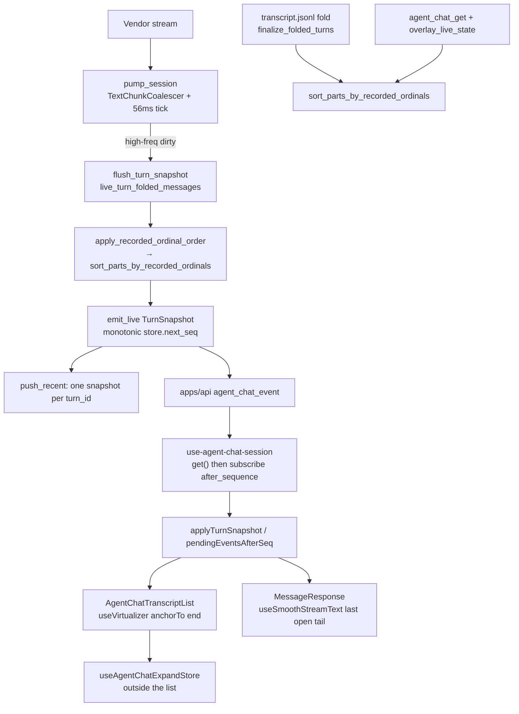

# TECH · QUALITY-008: Agent Chat UI Optimization

> Technical Design · HOW. As-built backfill for the Agent Chat stream / transcript work already on `main`.
> Documents [PR #305](https://github.com/AruNi-01/atmos/pull/305) (`6c58811b6`) plus the #307 recorded-ordinal slot-sort that #305 reused.
> Continues [APP-067-chat](../APP-067_atmos_agent_abs/TECH.md), [APP-068](../APP-068_agent_chat_arch_optimize/TECH.md), and [QUALITY-006](../QUALITY-006_agent-event-identity/TECH.md).

This is a `QUALITY-*` spec with no `PRD.md`. Product Chat identity, persistence, and the idempotent event model stay in those earlier specs. This file records the **UI and live-wire quality** that shipped after them.

## Scope summary

Stabilize Agent Chat while a turn is streaming and while the user is reading older rows:

1. Variable-height virtual transcript with bottom anchoring, so scroll-up reading does not jump when a row resizes.
2. Server live path emits cumulative `TurnSnapshot` on a ~56 ms merge tick, with monotonic `revision` and get-then-subscribe restore.
3. Client display pacing (`useSmoothStreamText` + 56 ms commit buffer) so tokens appear smoothly and flush on turn end / stop / error / reduced motion.
4. Expand / collapse state lives outside the virtual list, keyed by entry id, so remounts do not lose it.
5. One recorded-ordinal slot-sort shared by jsonl fold, live overlay, and `TurnSnapshot`.
6. Transient CLI spawn retries via named `libc` errnos (CI flake on just-written fakes).

Out of scope: changing APP-067 conversation identity, QUALITY-006 offset arithmetic, new `WsAction`s, persisting expand state across refresh, and Cursor mid-session permission chrome (existing ACP wiring).

## Quality target

| Metric                                      | Before #305 / #307                                                    | After (as shipped)                                                                                  |
| ------------------------------------------- | --------------------------------------------------------------------- | --------------------------------------------------------------------------------------------------- |
| Live WS text                                | Per-token / per-chunk events                                          | Cumulative `TurnSnapshot` on `COALESCE_FLUSH` (56 ms)                                               |
| Reconnect                                   | Replay / hydrate risk overlapping a later live snapshot               | `agent_chat_get` then `agent_chat_subscribe({ after_sequence })`; drop `revision <= last_event_seq` |
| Transcript scroll while reading upward      | Row resize shoved the reading line                                    | `anchorTo: "end"` + `shouldAdjustTranscriptScrollOnItemSizeChange`                                  |
| Tool / process / user-bubble expand         | Local React state died when the virtual row unmounted                 | Zustand `useAgentChatExpandStore`, keyed by entry id                                                |
| Process auto-collapse                       | Render-phase store write; remount could reopen                        | `useLayoutEffect` in `AssistantMessageView`; skip if `process:${id}` already stored                 |
| Assistant part order after reload / overlay | Unmapped text compared as `None` and dumped after tools               | Slot-sort only parts whose fold id is in the ordinal table                                          |
| Snapshot `created_at`                       | Could become `now` on each flush                                      | First part's `TrackedPart.opened_at`                                                                |
| Reconnect ring                              | A later turn's snapshot could evict an earlier turn's latest snapshot | `push_recent` keeps the latest `TurnSnapshot` **per `turn_id`**                                     |
| Chromium stream bench (see `RESULTS.md`)    | Unbatched per-token mean 1.795 ms / token                             | 56 ms snapshots + display buffer: 1.092 ms / token; scroll FPS ~55 both sides                       |

## Motivation / problems

These are the defects the shipped code actually addresses — not a product wishlist.

**Scroll jump when reading upward.** Chat rows grow (markdown, tools, user-bubble expand, timestamp row). A virtualizer that always compensates size changes shifts `scrollTop` and the line the user is reading jumps. `AgentChatTranscriptList` now uses TanStack Virtual `anchorTo: "end"` for stick-to-bottom, and `shouldAdjustTranscriptScrollOnItemSizeChange` (`apps/web/src/features/agent/lib/agent-chat-transcript-window.ts`) only shifts after first measure when the resized row is **entirely above the fold** and the user is not scrolling backward.

**Streaming smoothness vs per-token React commits.** QUALITY-006 M5 designed a 150 ms server flush. The shipped pump uses `COALESCE_FLUSH = 56ms` (`crates/core-service/src/service/agent_chat/coalesce.rs`). High-frequency `TextChunk` / `ToolCallUpdated` / `PlanUpdated` dirty a live snapshot; discrete events flush the snapshot **before** they are dispatched. The client still batches React commits (`AGENT_CHAT_COMMIT_FLUSH_MS = 56`) and display-buffers only the last open answer text.

**Collapse / expand state loss.** Virtual rows unmount. Local `useState` on the card reset on remount (process rail reopened, user bubble re-collapsed, tool cards forgot open). Expand flags moved to `useAgentChatExpandStore`. `reset()` runs only when `activeChatId` changes or the session unmounts — not on websocket reconnect.

**Render-phase store writes.** Process auto-collapse used to write the expand store during render. Zustand notified every `AssistantMessageView` and React flagged setState-in-render. Auto-collapse now runs in `useLayoutEffect` and **skips** when `process:${messageId}` is already stored, so a remount cannot reopen a user-collapsed panel.

**Part order after disk reload / live overlay.** #307: host ordinals existed in memory, but `TranscriptEvent::ToolCall` did not persist them; fold is append-order, so reload grouped tools then thinking. A later sort compared **every** part; text missing from the live ordinal map compared as `None` and `(Some, None)` parked that text at the end. Slot-sort only numbered parts; unmapped body text keeps its slot.

**Reconnect dropping a finished turn's snapshot.** `recent_events` is a capped ring (`RECENT_EVENT_CAP = 2048`). Keeping only one global latest snapshot would let turn N+1 evict turn N. `push_recent` retains the latest `TurnSnapshot` **per `turn_id`**.

**Snapshot timestamp drift.** Flushing a cumulative snapshot with `Utc::now()` made `created_at` walk forward every 56 ms. New assistant rows take `created_at` from the first part's `opened_at` (`overlay_tracked_part`).

**CI spawn flake.** `cargo test --workspace` writes a fake CLI then `exec`s it immediately. Linux returns `ETXTBSY` until the writer's fd closes. Shared `retry_transient_spawn` retries named `libc` errnos.

## Architecture overview



Layers touched (already shipped):

| Layer                 | Paths                                                                                        |
| --------------------- | -------------------------------------------------------------------------------------------- |
| `crates/agent`        | `src/providers/spawn_retry.rs`; Claude / Codex / Grok / OpenCode / Pi `spawn.rs`             |
| `crates/core-service` | `service/agent_chat/{coalesce,apply_event,service,store,types,tests}.rs`                     |
| `packages/api-types`  | `src/ws/dto/agent-chat.ts` `type: "turn_snapshot"`                                           |
| `packages/ui`         | `smooth-stream-text.ts`, `message.tsx` `MessageResponse`, `prompt-input.tsx` IME guard       |
| `apps/web`            | `features/agent` list / expand store / session / fold / commit buffer                        |
| `apps/mobile`         | `features/agent-chat/fold-transcript.ts` same `shouldAdoptSnapshotAssistant` / snapshot fold |
| Bench                 | `scripts/agent-chat-stream-perf/` (not imported by Next)                                     |

No new REST. Live Chat stays on existing `agent_chat_*` WS actions.

## Module-by-module design

### Server live merge — `coalesce.rs` + `pump_session`

`COALESCE_FLUSH` is `Duration::from_millis(56)` — documented as the 50–60 ms band so clients see cumulative snapshots without a per-token flood. `TextChunkCoalescer` lossless-concats adjacent / overlapping `TextChunk`s (`concat_adjacent_text`); any other envelope flushes pending chunks first.

`pump_session` (`crates/core-service/src/service/agent_chat/service.rs`):

- `tokio::select!` on `session.next_event()` and `flush_tick` (`MissedTickBehavior::Skip`).
- High-frequency events (`is_high_frequency_agent_event`: `TextChunk`, `ToolCallUpdated`, `PlanUpdated`) dispatch first, then `flush_turn_snapshot` when the tick fired or a discrete event arrived.
- Discrete events dispatch **after** the snapshot so the client sees merged text before `ToolCallStarted` / `TurnCompleted`.
- Loop exit flushes leftover chunks and one last snapshot.

`flush_turn_snapshot` (`apply_event.rs`) no-ops unless `state.snapshot_dirty`. It builds `open_part_ids` from live-turn parts with `closed_at.is_none()`, folds via `live_turn_folded_messages`, then `emit_live(TurnSnapshot { turn_id, messages, open_part_ids })`.

`emit_with_seq` assigns `revision` from `store.next_seq` (monotonic per chat) unless a caller passes `assigned_seq`.

### Reconnect cache — `push_recent`

`push_recent` drops raw `TextChunk` from the ring (live clients are on snapshots). For `TurnSnapshot`, it `retain`s other events and **other turns'** snapshots, then pushes the new one. Cap remains `RECENT_EVENT_CAP = 2048`. Extra byte budget for per-turn snapshots is accepted; it is reconnect correctness, not a new size constant.

`events_after(chat_id, after_sequence)` returns `revision > after_sequence`.

### Recorded-ordinal slot-sort — shared rule

The **shared sort** is public `sort_parts_by_recorded_ordinals` in `crates/core-service/src/service/agent_chat/types.rs`:

- Collect slot indexes whose `message_part_fold_id` is in `ordinals` (text via stored `part_id`, thinking/tool via their ids).
- If fewer than two numbered slots, fall through to `order_assistant_parts`.
- Sort only those parts by `(ordinal, original_index)` and write them back into the same slots.
- Unmapped parts (session chrome, or disk text missing from a live overlay map) keep relative positions.
- Older jsonl without recorded ordinals keeps append order.

Call sites:

| Path                   | Function                                                         | Notes                                |
| ---------------------- | ---------------------------------------------------------------- | ------------------------------------ |
| jsonl fold             | `store.rs` `finalize_folded_turns`                               | Uses persisted ordinal map           |
| Live overlay / `get()` | `apply_event.rs` `apply_recorded_ordinal_order` → the sort above | Builds map from `RuntimeState.parts` |
| Live `TurnSnapshot`    | `live_turn_folded_messages` → `apply_recorded_ordinal_order`     | Same wrapper                         |

`apply_recorded_ordinal_order` is the live/overlay wrapper (assistant messages only). The brief's "shared `apply_recorded_ordinal_order` rule" is this wrapper plus `sort_parts_by_recorded_ordinals`; jsonl fold calls the latter directly.

#307 also persists `ordinal: Option<u32>` on `TranscriptEvent::ToolCall` (`tool_call_with_ordinal`).

### Client restore — get then subscribe

`use-agent-chat-session.ts` `load()` calls `agentChatApi.get(id)` and returns `meta.last_event_seq`. After hydrate, `pendingEventsAfterSeq(pending, snapshotSeq)` keeps `revision > snapshotSeq`, then `agentChatApi.subscribe(id, after)` (`apps/web/src/api/ws/agent-chat-api.ts` → `agent_chat_subscribe`).

`applyTurnSnapshot` (`apps/web/src/features/agent/lib/agent-chat-events.ts`) replaces current-turn messages by id, keeps historical object identity, stamps `open_part_ids` onto parts, and may **adopt** a provisional assistant via `shouldAdoptSnapshotAssistant`:

1. Same-role assistants with different ids.
2. Shared `tool_call_id` → adopt (tool-first `assistant:<user-id>` → snapshot `tool-<id>`).
3. Provisional id `assistant` or `assistant:*` → adopt.
4. Else adopt if `prev` has **no** `text` or `thinking` parts.

Mobile `apps/mobile/src/features/agent-chat/fold-transcript.ts` copies the same adopt rule.

`hydrateAgentChatMessages` remains as a `text_chunk` replay fallback. Production restore does **not** call it (asserted in `agent-chat-transcript-window.test.ts`).

Subscribe order stays **get / replay pending, then register**. Swapping to subscribe-first can let an older missed snapshot overwrite a newer live snapshot. `get()` overlays live state; per-turn `push_recent` covers completed turns. Atomic subscribe-with-seq-dedup is not in this work.

### Virtual list — `AgentChatTranscriptList`

`apps/web/src/features/agent/components/AgentChatTranscriptList.tsx`:

- `@tanstack/react-virtual` `useVirtualizer`: `measureElement`, overscan 8, gap 12, estimates 88 / 240 / 480 (mermaid), `anchorTo: "end"`, `scrollEndThreshold: TRANSCRIPT_END_SLACK_PX` (24), `useFlushSync: false` (measure during commit + flushSync warns on React 19).
- `getItemKey` → `stableAgentMessageKey` (id, or `legacy:role:…` fingerprint; collisions get `#2` / `#3` via `withStableAgentMessageIds`).
- `shouldAdjustScrollPositionOnItemSizeChange` delegates to `shouldAdjustTranscriptScrollOnItemSizeChange`.
- Does **not** subscribe to `useStickToBottomContext` identity (it changes every scroll tick). `StickToBottomStop` copies `stopScroll` through a ref.
- `overflowAnchor: "none"` on the list box.
- Timeline jumps use `measurementsCache` + `scrollTo`, falling back to `virtualizer.scrollToIndex` for unmounted rows.

A product-shaped copy of this list (not full `AgentChatMessageView`) is the Chromium bench in `scripts/agent-chat-stream-perf/`.

### Expand-state store

`apps/web/src/features/agent/store/agent-chat-expand-store.ts` — Zustand map `values: Record<string, boolean>`:

| Key helper                    | Shape                         | Used for                                 |
| ----------------------------- | ----------------------------- | ---------------------------------------- |
| `agentChatProcessExpandKey`   | `process:${messageId}`        | Process rail                             |
| `agentChatInspectExpandKey`   | `inspect:${messageId}`        | User inspected tools during stream       |
| `agentChatToolGroupExpandKey` | `group:${messageId}:${group}` | Tool groups                              |
| `agentChatToolExpandKey`      | `tool:${toolCallId}`          | Tool cards with a non-blank id           |
| `agentChatPlanExpandKey`      | `plan:${scope}`               | Plan block                               |
| `agentChatUserBodyExpandKey`  | `user-body:${entryId}`        | User bubble past three-line / paste-chip |
| `agentChatUserMetaExpandKey`  | `user-meta:${entryId}`        | Timestamp + copy row                     |

`setExpand` no-ops when the value is unchanged. Blank `tool_call_id` must **not** enter the store (`AgentToolCard`: `useAgentToolExpandId()?.trim() || null`) — every empty id would hash to `tool:` and one card would toggle all id-less cards. Those cards stay uncontrolled `Collapsible` local state.

`use-agent-chat-session.ts` resets the store on `activeChatId` change / unmount only.

`AssistantMessageView` auto-collapse on first settle:

```ts
useLayoutEffect(() => {
  if (canCollapse && !wasCollapsibleRef.current) {
    const stored = useAgentChatExpandStore.getState().values;
    if (!Object.prototype.hasOwnProperty.call(stored, processKey)) {
      setStepsExpanded(
        density === "detailed" || !shouldAutoCollapseProcessOnSettle(userInspecting),
      );
    }
  }
  wasCollapsibleRef.current = canCollapse;
}, [/* … */]);
```

### Display pacing

Three stacked clocks, all 56 ms or rAF — not QUALITY-006's designed 150 ms:

1. **Server** `COALESCE_FLUSH` / `TurnSnapshot`.
2. **Client commit** `createAgentChatCommitBuffer` — `turn_snapshot` batches; `turn_completed` and `session_lifecycle` force-flush (`classifyCommitCadence`).
3. **Display** `useSmoothStreamText` (`packages/ui/src/components/ai-elements/smooth-stream-text.ts`): rAF drain with `BASE_CPS` / `MAX_CPS` / `DRAIN_AFTER`. `enabled === false` paints the full target immediately.

`MessageResponse` (`message.tsx`): `streaming = !reducedMotion && isAnimating`. Reduced motion (`useReducedMotion`) shows source text and disables Streamdown animation.

Only the last open answer text is display-buffered (`foldedPartIsStreamingDisplayTail` in `folded-agent-part.ts`). Earlier open blocks keep caret only. Turn-end / stop / error turn `isAnimating` off so the hook returns the full source.

Composer Enter ignores IME composition in `PromptInputTextarea` (`isComposing` state + `e.nativeEvent.isComposing`, `onCompositionStart` / `onCompositionEnd`). That guard is **not** verified on a real Chinese IME in this environment.

### `created_at` from open time

`overlay_tracked_part` creates a new assistant `FoldedMessage` with `created_at: opened_at` (the `TrackedPart.opened_at` captured when the part first appeared). Later flushes upsert into that row and do not rewrite `created_at`. Test: `live_turn_snapshot_keeps_first_part_opened_at`.

### Spawn retry

`crates/agent/src/providers/spawn_retry.rs`:

- `TRANSIENT_SPAWN_ATTEMPTS = 8`
- `is_transient_os_error` matches `libc::EINTR`, `EAGAIN`, `EWOULDBLOCK`, `ENFILE`, `EMFILE`, `ETXTBSY` (named constants, not Linux numbers). `EDEADLK` must not retry (Darwin `EDEADLK` is 11, Linux `EAGAIN` is 11).
- Backoff `10 * attempt` ms.

Used by Claude, Codex, Grok, OpenCode, and Pi spawn paths.

## Data model

No new tables. Wire addition (already in `@atmos/api-types`):

```ts
{
  type: "turn_snapshot";
  turn_id: string;
  messages: AgentMessage[];
  open_part_ids?: string[];
}
```

Rust: `AgentChatPayload::TurnSnapshot { turn_id, messages, open_part_ids }` in `types.rs`. Persistence remains jsonl + `live.jsonl` from QUALITY-006; snapshots are **live WS only** and are not a second transcript shape.

## Transport

Existing WS only:

| Action / event         | Role in this work                                                           |
| ---------------------- | --------------------------------------------------------------------------- |
| `agent_chat_get`       | Snapshot + `meta.last_event_seq` + live overlay                             |
| `agent_chat_subscribe` | `{ chat_id, after_sequence }` — events with `revision > after_sequence`     |
| `agent_chat_event`     | Live `turn_snapshot` (and discrete events after a pre-flush)                |
| `agent_chat_backfill`  | Unchanged QUALITY-006 suffix path; still used if a `text_chunk` gap appears |

No new REST. No new `WsAction`.

## Security & permissions

- Bench static server (`scripts/agent-chat-stream-perf/public-file.ts`) serves only `/`, `/index.html`, and `/bench.js`; traversal returns 403.
- Expand store is in-memory only — no transcript content written to `localStorage`.
- Spawn retry does not broaden permission policy. Cursor Agent + Ask always still does not emit ACP `session/request_permission` for ordinary writes; that is existing Cursor wiring (`crates/agent/AGENTS.md`), not a #305 regression.

## Rollout plan

Already shipped. Historical order, not a future checklist:

1. **#307** (`c7d2c6c2`) — persist tool ordinals; `sort_parts_by_recorded_ordinals` slot-sort; CI / e2e unblock (out of this spec except the sort rule).
2. **#305** (`6c58811b6`) — virtual list anchoring + expand store + `TurnSnapshot` 56 ms + display buffer + `push_recent` per turn + `opened_at` + spawn retry + bench.
3. **This spec** — documentation backfill only.

Rollback for the product change remains git revert of those merges. Local chats stay disposable (`rm -rf ~/.atmos/data/agent-chat`) if a future wire change lands.

## Known limitations and follow-ups

| Item                                         | Status in code                                                                                                                                                                                                                    | Follow-up                                                 |
| -------------------------------------------- | --------------------------------------------------------------------------------------------------------------------------------------------------------------------------------------------------------------------------------- | --------------------------------------------------------- |
| `shouldAdoptSnapshotAssistant` last fallback | After tool-id and `assistant:` checks, adopts when `prev` has no text/thinking. Two **tool-only** assistants in the same turn can merge into one row (`currentTurnAssistant` is the last assistant). Same copy on mobile.         | Tighten adopt to shared tool ids / provisional ids only.  |
| Chinese IME composition                      | `PromptInputTextarea` already guards Enter with `isComposing` / `nativeEvent.isComposing`. **Not verified on a real IME** (no IME on the verification VM).                                                                        | Real-device IME pass.                                     |
| Expand state across refresh                  | Store is process memory. Refresh collapses process rail (default). WS reconnect of the same `activeChatId` keeps keys.                                                                                                            | Persist only if product asks.                             |
| Cursor mid-session permission prompt         | Official `cursor-agent acp` + Ask always did not emit `session/request_permission` for a write to `/tmp`. Existing Cursor ACP: no mid-session permission `configId`. Plan **Approve** is the confirmation chrome that did appear. | Not a QUALITY-008 bug.                                    |
| Blank `tool_call_id` cards                   | Uncontrolled; remount does not restore expand. Intentional.                                                                                                                                                                       | Keep.                                                     |
| `hydrateAgentChatMessages`                   | Still exported for `text_chunk` clients. Production session path does not call it.                                                                                                                                                | Delete when no live client remains on chunks.             |
| QUALITY-006 M5 150 ms                        | Shipped clocks are **56 ms** server + 56 ms client commit. Follow the code, not the 150 ms design number.                                                                                                                         | Update QUALITY-006 if that design is formally superseded. |

## Risks & tradeoffs

- **Tradeoff: 56 ms vs 150 ms.** Tighter merge looks closer to per-token streaming; still bounds WS and React commits. QUALITY-006's 150 ms figure is not what shipped.
- **Tradeoff: subscribe after get.** Avoids an older missed snapshot covering a newer live one. Clients that only listen without `get()` see nothing until the next snapshot.
- **Risk: adopt heuristic.** Tool-only fallback can merge two tool-only messages. Prefer shared `tool_call_id` when present.
- **Risk: in-memory expand.** Refresh looks like "process collapsed"; expanding restores tools + text. Do not treat that as data loss.
- **Risk: spawn retry exhaustion.** Eight transient failures still surface as spawn errors (no longer misread as too-old Claude).
- **Rollback:** revert #305 / #307. No schema migration.

## Dependencies & compatibility

- Builds on [APP-067](../APP-067_atmos_agent_abs/TECH.md) (`agent_chat_get` then subscribe from `after_sequence`; file transcript).
- Builds on [APP-068](../APP-068_agent_chat_arch_optimize/TECH.md) (Atmos descriptor + native/ACP hosts).
- Builds on [QUALITY-006](../QUALITY-006_agent-event-identity/TECH.md) (idempotent `TextChunk` / part ids / fold). This spec does **not** reopen offset arithmetic. It changes the **live emit** from per-chunk WS to coalesced `TurnSnapshot` and the **UI** around that fold.
- No backward-compat shim for old live clients that only understand `text_chunk`: they see text on the 56 ms snapshots (or not at all if they ignore `turn_snapshot`).
- Mobile uses the same snapshot fold; it does not use the web virtual list or expand store.

## Audit commands

```bash
rg -n 'COALESCE_FLUSH|TurnSnapshot|apply_recorded_ordinal_order|sort_parts_by_recorded_ordinals' crates/core-service/src/service/agent_chat
rg -n 'anchorTo: \"end\"|shouldAdjustTranscriptScrollOnItemSizeChange|useAgentChatExpandStore' apps/web/src/features/agent
rg -n 'shouldAdoptSnapshotAssistant|applyTurnSnapshot|pendingEventsAfterSeq' apps/web/src/features/agent apps/mobile/src/features/agent-chat
rg -n 'useSmoothStreamText|AGENT_CHAT_COMMIT_FLUSH_MS' packages/ui/src apps/web/src/features/agent
rg -n 'retry_transient_spawn|EINTR|ETXTBSY' crates/agent/src/providers
```

## Verification commands

```bash
cargo test -p core-service --lib service::agent_chat
cargo test -p agent --lib spawn_retry
cd apps/web && bun test src/features/agent/lib/__tests__/agent-chat-events.test.ts \
  src/features/agent/lib/__tests__/agent-chat-stream-wiring.test.ts \
  src/features/agent/lib/__tests__/agent-chat-transcript-window.test.ts \
  src/features/agent/lib/__tests__/agent-chat-commit-buffer.test.ts \
  src/features/agent/lib/__tests__/smooth-stream-text.dom.test.tsx \
  src/features/agent/lib/__tests__/agent-chat-message-key.test.ts \
  src/features/agent/store/__tests__/agent-chat-expand-store.test.ts \
  src/features/agent/components/__tests__/assistant-message-process-collapse.test.ts \
  src/features/agent/components/__tests__/folded-agent-part.test.ts \
  src/features/agent/components/__tests__/user-message-body.dom.test.tsx
bun test scripts/agent-chat-stream-perf/public-file.test.ts
bun test apps/mobile/src/features/agent-chat/fold-transcript.test.ts
```

Chromium numbers: `scripts/agent-chat-stream-perf/RESULTS.md` (authoritative). Re-run: `bun scripts/agent-chat-stream-perf/run.ts`.
