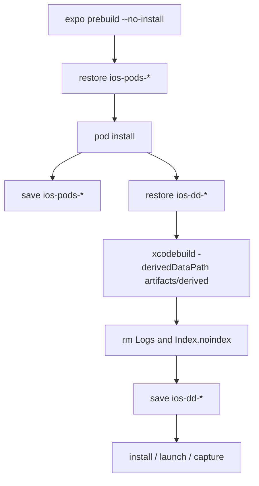

# TECH · QUALITY-022: iOS Simulator CI Cache

> Technical Design · HOW. Speeds up the `ios-simulator` job in `.github/workflows/ci-mobile-ios-parity.yml` with CocoaPods and Xcode DerivedData caches. No BRAINSTORM or PRD (quality spec). The `ios-parity` label gate from [QUALITY-010](../QUALITY-010_audit-safety-hardening/TECH.md) stays.

## Scope summary

`ios-simulator` on `macos-26` is about half of Atmos CI wall time (often 50–180 minutes). Every run currently:

1. Regenerates `apps/mobile/ios` with `expo prebuild --no-install` (`ios/` is gitignored).
2. Runs a cold `pod install`.
3. Deletes DerivedData and runs a clean `xcodebuild` (`rm -rf "$derived"`).

This spec caches the two expensive trees. It does not change triggers, does not add the `ios-parity` label, does not raise `oxlint --max-warnings=455`, and does not commit screenshots, evidence files, or hostnames.

Numbering: `origin/main` last published **QUALITY-020** (E2E prebuilt API artifact, #342). Concurrent draft [PR #344](https://github.com/AruNi-01/atmos/pull/344) registered **QUALITY-021** for CodeQL advanced config, so this spec is **QUALITY-022**.

Out of scope:

- Speeding up the ubuntu `structural` job.
- Bundling or caching `~/.atmos`, simulators, or Xcode.app.
- Making `ios-simulator` required, or running it on every push.
- ccache / sccache (DerivedData first; a compiler cache can be a follow-up).

## Quality target

| Item              | Before                                       | After                                                                                       |
| ----------------- | -------------------------------------------- | ------------------------------------------------------------------------------------------- |
| CocoaPods         | Cold `pod install` every run                 | Restore `Pods` + `~/Library/Caches/CocoaPods` when the key matches                          |
| Xcode DerivedData | `rm -rf` then clean `xcodebuild`             | Restore `$GITHUB_WORKSPACE/artifacts/derived`; same `-derivedDataPath`                      |
| Cache key         | None                                         | `runner.os` + `xcodebuild -version` + scope + `bun.lock` + Podfile / `Podfile.lock`         |
| Fallback          | None                                         | Ordered `restore-keys` from specific to `runner.os`                                         |
| Cache size        | N/A                                          | No Index store; prune `Logs` / `Index.noindex` before save; scope is PR number or ref       |
| Trigger           | `workflow_dispatch` or PR label `ios-parity` | Unchanged                                                                                   |
| Save timing       | N/A                                          | Save CocoaPods after `pod install`; save DerivedData after `xcodebuild`, **before** capture |

## Architecture overview

```
ios-simulator (macos-26, still label-gated)
  checkout → bun install
  xcode-select Xcode 26.5
    record GITHUB_OUTPUT version (xcodebuild -version) and scope
  boot iPhone 17 Pro (unchanged)
  expo prebuild -p ios --no-install     → ios/Podfile exists
  restore CocoaPods cache
  pod install
  save CocoaPods cache                  → survives a later capture timeout
  restore DerivedData cache             → Podfile.lock exists
  xcodebuild -derivedDataPath artifacts/derived  COMPILER_INDEX_STORE_ENABLE=NO
  prune Logs + Index.noindex
  save DerivedData cache                → before capture
  simctl install + ios-capture.sh       → unchanged
```



## Cache key design

`ios/` is gitignored. `Podfile.lock` is **not** in the checkout. CocoaPods restore therefore cannot hash a committed lockfile. DerivedData restore runs **after** `pod install`, so it can hash the generated lock.

Scope (from the Xcode step, env in / shell out — QUALITY-015):

| Event               | `steps.xcode.outputs.scope`     |
| ------------------- | ------------------------------- |
| `pull_request`      | `pr-<number>`                   |
| `workflow_dispatch` | `ref-<ref_name>` with `/` → `-` |

GitHub already isolates PR caches to `refs/pull/.../merge` (sibling PRs cannot read them; they can read `main`). The scope segment still makes the **exact** key unique per PR so a re-run of the same PR is an exact hit, and `restore-keys` can fall back to another scope on the same Xcode (typically `main` after that job has run there).

Xcode version: `xcodebuild -version` awk `NR==1 $2` + `NR==2 $3` → `26.5-17C529`. Spaces never enter the key.

### CocoaPods (`id: cocoapods-restore` / save)

Paths:

- `apps/mobile/ios/Pods`
- `~/Library/Caches/CocoaPods`

Exact key:

```text
ios-pods-${{ runner.os }}-${{ steps.xcode.outputs.version }}-${{ steps.xcode.outputs.scope }}-${{ hashFiles('bun.lock') }}-${{ hashFiles('apps/mobile/ios/Podfile') }}
```

`restore-keys` (most specific first):

```text
ios-pods-${{ runner.os }}-${{ steps.xcode.outputs.version }}-${{ steps.xcode.outputs.scope }}-${{ hashFiles('bun.lock') }}-
ios-pods-${{ runner.os }}-${{ steps.xcode.outputs.version }}-${{ steps.xcode.outputs.scope }}-
ios-pods-${{ runner.os }}-${{ steps.xcode.outputs.version }}-
ios-pods-${{ runner.os }}-
```

`Podfile.lock` is not in this key: it does not exist at restore time. The generated `Podfile` plus root `bun.lock` are the pre-install fingerprint. The lock hash is in the DerivedData key below.

### DerivedData (`id: deriveddata-restore` / save)

Path: `${{ github.workspace }}/artifacts/derived` — the same path as `-derivedDataPath`. Job env `DERIVED_DATA` holds it. Do **not** `rm -rf` that directory before `xcodebuild`.

Exact key (includes `Podfile.lock` after `pod install`):

```text
ios-dd-${{ runner.os }}-${{ steps.xcode.outputs.version }}-${{ steps.xcode.outputs.scope }}-${{ hashFiles('bun.lock') }}-${{ hashFiles('apps/mobile/ios/Podfile.lock') }}
```

`restore-keys`:

```text
ios-dd-${{ runner.os }}-${{ steps.xcode.outputs.version }}-${{ steps.xcode.outputs.scope }}-${{ hashFiles('bun.lock') }}-
ios-dd-${{ runner.os }}-${{ steps.xcode.outputs.version }}-${{ steps.xcode.outputs.scope }}-
ios-dd-${{ runner.os }}-${{ steps.xcode.outputs.version }}-
ios-dd-${{ runner.os }}-
```

### Invalidation

| Change                                       | CocoaPods exact | DerivedData exact     |
| -------------------------------------------- | --------------- | --------------------- |
| Xcode / runner OS                            | miss            | miss                  |
| Other PR (GitHub branch scope + key scope)   | miss            | miss                  |
| `bun.lock`                                   | miss            | miss                  |
| Generated `Podfile` (prebuild / autolinking) | miss            | often miss via lock   |
| `Podfile.lock` after `pod install`           | still exact     | miss                  |
| JS/TS only, same pods                        | hit             | hit (prefix or exact) |

A `restore-keys` hit is a cache **restore**, not `outputs.cache-hit == 'true'`. `cache-hit` is exact-key only. Logs must print `cache-matched-key` as well.

## DerivedData path and size

- `xcodebuild` keeps `-derivedDataPath "$DERIVED_DATA"` with `DERIVED_DATA=$GITHUB_WORKSPACE/artifacts/derived`.
- Pass `COMPILER_INDEX_STORE_ENABLE=NO` so CI does not write `Index.noindex` (editor index, large, unused here).
- Before save: `rm -rf "$DERIVED_DATA/Logs" "$DERIVED_DATA/Index.noindex"`.
- Split `actions/cache/restore@v4` and `actions/cache/save@v4` so CocoaPods can be saved even if `xcodebuild` fails, and DerivedData can be saved even if capture later times out.
- Save CocoaPods when `pod install` succeeded (`always() && !cancelled()`).
- Save DerivedData only when `xcodebuild` succeeded.

Do not restrict save to `main` only. A PR re-run is how we measure miss vs hit; GitHub stores that cache on the merge ref, not on `main`.

Cache save uses the Actions cache service (`cache-mode` defaults to write on `pull_request` / `workflow_dispatch`), not `GITHUB_TOKEN` `actions: write`. Workflow `permissions` stay `contents: read`.

## Trigger (must not change)

```yaml
on:
  workflow_dispatch:
  pull_request:
    types: [opened, synchronize, reopened, labeled, unlabeled]
    paths: [unchanged]

ios-simulator:
  if: >-
    github.event_name == 'workflow_dispatch' ||
    (github.event_name == 'pull_request' && contains(github.event.pull_request.labels.*.name, 'ios-parity'))
```

No `push:` trigger. Do not apply the `ios-parity` label from this work.

## How to get miss vs hit timings

The Eng Manager applies `ios-parity` (this change does not). Then:

1. First `ios-simulator` run on the PR: expect CocoaPods and DerivedData **miss** (`cache-hit != true`, no `cache-matched-key` or a `restore-keys` fallback from `main` only). The job saves both caches after `pod install` / `xcodebuild`.
2. **Re-run** that completed job (same SHA, Actions “Re-run jobs”). Expect exact hits: `cache-hit=true` and `cache-matched-key` equal to the exact key. Compare job duration and the `pod install` / `xcodebuild` step durations.
3. If the first run is cancelled by `concurrency` before the save steps, there is no cache to hit — wait for a green or at least post-`xcodebuild` run.

Write `cache-hit` and `cache-matched-key` into `artifacts/summary.md` (no hostname).

## Affected files

| Area  | Files                                                                                  |
| ----- | -------------------------------------------------------------------------------------- |
| CI    | `.github/workflows/ci-mobile-ios-parity.yml`                                           |
| Tests | `apps/mobile/script/ios-parity-ci-cache.test.ts` (picked up by `apps/mobile` bun test) |
| Spec  | this directory, `specs/README.md` row **QUALITY-022**                                  |

## Risks & tradeoffs

- **Checkout mtimes.** `actions/checkout` sets worktree mtimes to now, so clang may rebuild more `.o` files than a local incremental build. ModuleCache and CocoaPods still help. Not fixing mtimes in this spec.
- **Stale Products.** A `restore-keys` hit can restore objects from a different `Podfile.lock`. `xcodebuild` still runs; the existing `main.jsbundle` / SceneDelegate gates fail the job if the binary is wrong. Accept prefix hits.
- **10 GB repo cache cap.** Unpruned DerivedData can evict other caches. Index/Logs stay out. If a save fails for size, the job still continues (cache action warning); `pod install` / `xcodebuild` remain correct, just slower.
- **Fork PRs.** Caches written on `pull_request` stay on the merge ref. This repo’s ios job is label-gated on the home repo; we do not add `pull_request_target`.
- **QUALITY-015.** No `${{ github.event.* }}` inside `run:` bodies. Scope uses step `env:` + `"$PR_NUMBER"` / `"$REF_NAME"`.

## Rollout

1. Register QUALITY-022 and this TECH/TEST.
2. Workflow + bun tests.
3. Draft PR; `structural` and non-iOS CI must be green.
4. Eng Manager labels `ios-parity` when they want miss vs hit numbers.

## Follow-ups

- Restore git mtimes or add ccache if DerivedData hits still recompile most translation units.
- Drop `restore-keys` that cross `Podfile.lock` if a stale prefix hit ever ships a bad binary (not observed; gates should catch it).
