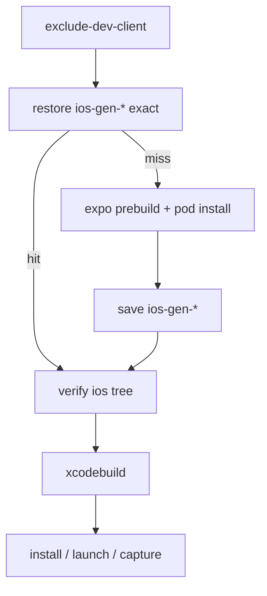

# TECH · QUALITY-022: iOS Simulator CI Cache

> Technical Design · HOW. Speeds up the `ios-simulator` job in `.github/workflows/ci-mobile-ios-parity.yml` by caching the generated `ios/` tree so `expo prebuild` and `pod install` can be skipped on an exact hit. CocoaPods downloads are cached on the miss path. Xcode DerivedData is **not** cached. No BRAINSTORM or PRD (quality spec). The `ios-parity` label gate from [QUALITY-010](../QUALITY-010_audit-safety-hardening/TECH.md) stays.

## Scope summary

`ios-simulator` on `macos-26` is about half of Atmos CI wall time (often 50–180 minutes). `ios/` is gitignored, so every run used to:

1. Regenerate `apps/mobile/ios` with `expo prebuild --no-install`.
2. Run `pod install` (codegen + generate Pods project + integrate the app).
3. Run a clean `xcodebuild`.

Numbering: `origin/main` last published **QUALITY-020** (E2E prebuilt API artifact, #342). Concurrent drafts: [PR #344](https://github.com/AruNi-01/atmos/pull/344) is **QUALITY-021** (CodeQL), [PR #346](https://github.com/AruNi-01/atmos/pull/346) is **QUALITY-023** (split iOS capture). This spec is **QUALITY-022**.

This spec does not change triggers, does not add or remove the `ios-parity` label, does not raise `oxlint --max-warnings=455`, does not merge `main`, and does not commit screenshots, evidence files, or hostnames. `assert_cold_launch` flakiness is out of scope.

Out of scope:

- Speeding up the ubuntu `structural` job or the capture half of `ios-simulator`.
- Bundling or caching `~/.atmos`, simulators, Xcode.app, or DerivedData.
- Making `ios-simulator` required, or running it on every push.
- ccache / sccache.

## Decision: keep ios-gen, drop DerivedData

Eng Manager (after run [39550057846](https://github.com/AruNi-01/atmos/actions/runs/39550057846) on SHA `e2f88b00a`): **ios-gen stays; DerivedData cache and mtime pin are removed.**

### Old baseline — Pods-only restore, `pod install` always ran

Run [39530230224](https://github.com/AruNi-01/atmos/actions/runs/39530230224) on SHA `3581e6854`, same SHA, two attempts:

| Step                | Attempt 1 (miss)               | Attempt 2 (exact hit)                                                     |
| ------------------- | ------------------------------ | ------------------------------------------------------------------------- |
| Restore CocoaPods   | 2s miss                        | 41s hit (522 MB)                                                          |
| Install CocoaPods   | 2m20s, `Installing …` 121 pods | 2m19s, codegen + `Generating Pods project` + `Integrating client project` |
| Restore DerivedData | 1s miss                        | 58s hit (1.5 GB)                                                          |
| Build Release       | **27m07s**, CompileC 1402      | **49m01s**, CompileC 1322                                                 |

Exact Pods + DerivedData hits did **not** skip `pod install`. `expo prebuild` rewrote `ios/`. Codegen rewrote native sources. Clang rebuilt almost everything. Restoring 1.5 GB of `.o` files made the hit **22 minutes slower**.

### Retest — ios-gen skip + DerivedData exact + mtime pin

Run [39550057846](https://github.com/AruNi-01/atmos/actions/runs/39550057846) on SHA `e2f88b00a`:

| Step                          | Attempt 1 (ios-gen miss) | Attempt 2 (ios-gen exact hit) |
| ----------------------------- | ------------------------ | ----------------------------- |
| Restore generated iOS tree    | 2s miss                  | 41s hit                       |
| Prebuild iOS                  | 7s                       | **skipped**                   |
| Install CocoaPods             | 1m46s                    | **skipped**                   |
| Restore DerivedData           | 40s                      | 2m26s hit                     |
| Normalize native input mtimes | 41s                      | 1m14s                         |
| Build Release                 | 29m21s                   | 43m12s                        |
| CompileC                      | **1404**                 | **1404**                      |

ios-gen hit skipped prebuild and `pod install` and saved about **2 minutes**. DerivedData did **not** make clang incremental: CompileC stayed 1404. Restore + mtime pin added **1.5–3.5 minutes**, and Build was slower on the hit. Drop both.

## Quality target

| Item                | After                                                                                              |
| ------------------- | -------------------------------------------------------------------------------------------------- |
| Generated `ios/`    | Exact-key cache of `apps/mobile/ios`. Hit **skips** prebuild and `pod install`. No `restore-keys`. |
| CocoaPods downloads | `~/Library/Caches/CocoaPods` only on the miss path (prefix fallback allowed)                       |
| Xcode DerivedData   | **Not cached.** Local `-derivedDataPath artifacts/derived` only.                                   |
| Trigger             | Unchanged: `workflow_dispatch` or PR label `ios-parity`                                            |

## Architecture overview

```
ios-simulator (macos-26, still label-gated)
  checkout → bun install
  xcode-select Xcode 26.5; record version + scope
  boot iPhone 17 Pro (unchanged)
  bake .env + exclude-dev-client (mutates package.json)
  restore ios-gen-*                  → apps/mobile/ios
  miss: restore ios-podhome-* ; prebuild ; pod install ; save both
  hit: skip prebuild and pod install
  verify tree (Info.plist, SceneDelegate, Podfile.lock, .xcode.env.local)
  xcodebuild -derivedDataPath artifacts/derived  COMPILER_INDEX_STORE_ENABLE=NO
  simctl install + ios-capture.sh    → unchanged
```



## Cache key design

Scope (from the Xcode step, env in / shell out — QUALITY-015):

| Event               | `steps.xcode.outputs.scope`     |
| ------------------- | ------------------------------- |
| `pull_request`      | `pr-<number>`                   |
| `workflow_dispatch` | `ref-<ref_name>` with `/` → `-` |

Xcode version: `xcodebuild -version` awk `NR==1 $2` + `NR==2 $3` → `26.5-17F42`. Spaces never enter the key.

`hashFiles` for `ios-gen` runs **after** `exclude-dev-client.js` mutates `apps/mobile/package.json`.

### Generated iOS tree (`id: ios-restore` / save)

Path: `apps/mobile/ios` (Pods, `Podfile`, `Podfile.lock`, xcworkspace, pbxproj, codegen).

Exact key:

```text
ios-gen-${{ runner.os }}-${{ steps.xcode.outputs.version }}-${{ steps.xcode.outputs.scope }}-${{ hashFiles('bun.lock', 'apps/mobile/package.json', 'apps/mobile/app.config.js', 'apps/mobile/app.json', 'apps/mobile/plugins/**', 'apps/mobile/modules/**', 'scripts/agent-chat-parity/exclude-dev-client.js') }}
```

No `restore-keys`. `outputs.cache-hit == 'true'` is the only skip gate for prebuild / `pod install`.

### CocoaPods download cache (miss path only)

Path: `~/Library/Caches/CocoaPods`

```text
ios-podhome-${{ runner.os }}-${{ steps.xcode.outputs.version }}-${{ hashFiles('bun.lock') }}
```

`restore-keys`: xcode prefix, then `runner.os`. This only speeds a cold `pod install`.

### Invalidation

| Change                                                     | ios-gen exact          |
| ---------------------------------------------------------- | ---------------------- |
| Xcode / runner OS / other PR                               | miss                   |
| `bun.lock` / package.json / app config / plugins / modules | miss                   |
| JS/TS only, same native inputs                             | hit, skip prebuild+pod |

`summary.md` records ios-gen / cocoapods-home `cache-hit` + `cache-matched-key` and the `CompileC` count. No DerivedData cache lines. No hostname.

`xcodebuild` still uses `-derivedDataPath "$DERIVED_DATA"` with `COMPILER_INDEX_STORE_ENABLE=NO` so the job writes a local tree; that directory is not saved to Actions cache.

## Trigger (must not change)

```yaml
on:
  workflow_dispatch:
  pull_request:
    types: [opened, synchronize, reopened, labeled, unlabeled]

ios-simulator:
  if: >-
    github.event_name == 'workflow_dispatch' ||
    (github.event_name == 'pull_request' && contains(github.event.pull_request.labels.*.name, 'ios-parity'))
```

No `push:` trigger. This work does not add or remove the `ios-parity` label.

## How to get miss vs hit timings

The Eng Manager applies `ios-parity` when needed (this change does not). Then:

1. First `ios-simulator` on a SHA with this design: `ios-gen cache-hit` is not true. `Prebuild iOS` and `Install CocoaPods` run.
2. After that run finishes the ios-gen save, **Re-run jobs** on the **same SHA**. Expect ios-gen exact hit, skipped prebuild/pod install, about 2 minutes saved. `CompileC` stays a full rebuild (~1400); that is expected without DerivedData.
3. `summary.md` has ios-gen hit flags and CompileC. No hostname.

## Affected files

| Area  | Files                                                                                  |
| ----- | -------------------------------------------------------------------------------------- |
| CI    | `.github/workflows/ci-mobile-ios-parity.yml`                                           |
| Tests | `apps/mobile/script/ios-parity-ci-cache.test.ts` (picked up by `apps/mobile` bun test) |
| Spec  | this directory, `specs/README.md` row **QUALITY-022**                                  |

## Risks & tradeoffs

- **Stale `ios/` on a missed input.** If a prebuild input is not in `hashFiles`, an exact hit skips prebuild and ships an old native tree. The glob covers `package.json`, app config, plugins, modules, `bun.lock`, and `exclude-dev-client.js`. Add to that list when a new native input appears.
- **10 GB repo cache cap.** `ios/` is about 500 MB. A failed save is a warning; the job still continues.
- **QUALITY-015.** No `${{ github.event.* }}` inside `run:` bodies. Skip gates use `steps.*.outputs.cache-hit` in `if:`.

## Rollout

1. Register QUALITY-022 and this TECH/TEST.
2. Workflow + bun tests.
3. Draft PR; `structural` and non-iOS CI must be green.
4. Eng Manager labels / re-runs `ios-parity` to measure ios-gen miss vs hit. This PR does not change that label.

## Follow-ups

- ccache only if a later spec wants native incremental without DerivedData.
- Capture-step wall time is QUALITY-023 (#346), not this spec.
