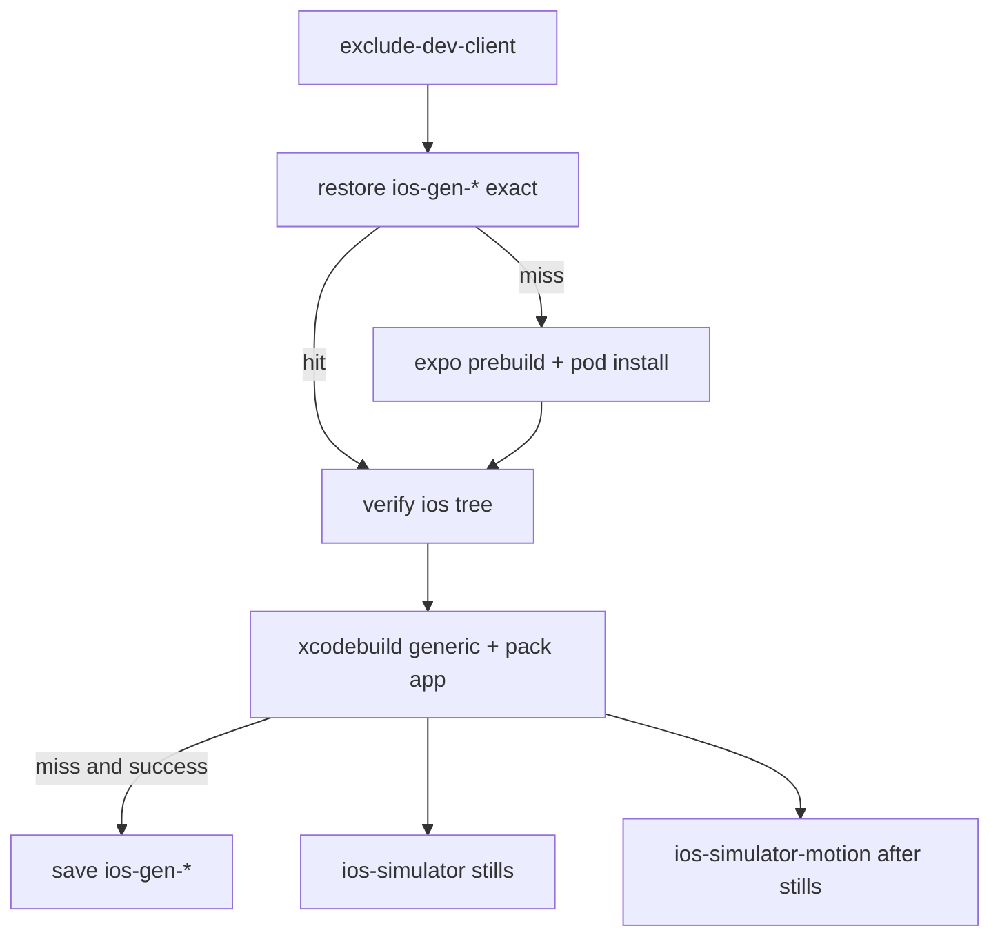

# TECH · QUALITY-022: iOS Simulator CI Cache

> Technical Design · HOW. Speeds up `ios-build` in `.github/workflows/ci-mobile-ios-parity.yml` by caching the generated `ios/` tree so `expo prebuild` and `pod install` can be skipped on an exact hit. CocoaPods downloads are cached on the miss path. Xcode DerivedData is **not** cached. No BRAINSTORM or PRD (quality spec). The `ios-parity` label gate from [QUALITY-010](../QUALITY-010_audit-safety-hardening/TECH.md) stays. Job graph is [QUALITY-023](../QUALITY-023_ios-parity-capture-speed/TECH.md): stills parallel after `ios-build`, motion serial after stills.

## Scope summary

`ios-build` on `macos-26` regenerates gitignored `ios/` on every miss:

1. Regenerate `apps/mobile/ios` with `expo prebuild --no-install`.
2. Run `pod install` (codegen + generate Pods project + integrate the app).
3. Run a clean `xcodebuild` (`generic/platform=iOS Simulator`) and pack `Atmos.app`.

Numbering: `origin/main` has **QUALITY-020** (#342), **QUALITY-021** (#344), **QUALITY-023** (#346, `704d16525`), **QUALITY-024** (#348). This spec is **QUALITY-022**. Cache steps live on `ios-build`, not on the stills/motion capture jobs.

This spec does not change triggers, does not add or remove the `ios-parity` label, does not raise `oxlint --max-warnings=455`, and does not commit screenshots, evidence files, or hostnames. `assert_cold_launch` flakiness is out of scope.

Out of scope:

- Speeding up ubuntu `structural` or the stills/motion capture jobs ([QUALITY-023](../QUALITY-023_ios-parity-capture-speed/TECH.md)).
- Bundling or caching `~/.atmos`, simulators, Xcode.app, or DerivedData.
- Making `ios-build` / capture jobs required, or running them on every push.
- ccache / sccache.
- Writing `EXPO_PUBLIC_PARITY_PREVIEW` into `.env` or `ios/.xcode.env.local` (QUALITY-023: step `env:` only).

## Decision: keep ios-gen, drop DerivedData

Eng Manager (after run [39550057846](https://github.com/AruNi-01/atmos/actions/runs/39550057846) on SHA `e2f88b00a`): **ios-gen stays; DerivedData cache and mtime pin are removed.**

### Old baseline — Pods-only restore, `pod install` always ran

Run [39530230224](https://github.com/AruNi-01/atmos/actions/runs/39530230224) on SHA `3581e6854`, same SHA, two attempts:

| Step                | Attempt 1 (miss)               | Attempt 2 (exact hit)                                                     |
| ------------------- | ------------------------------ | ------------------------------------------------------------------------- |
| Restore CocoaPods   | 2s miss                        | 41s hit (522 MB)                                                          |
| Install CocoaPods   | 2m20s, `Installing …` 121 pods | 2m19s, codegen + `Generating Pods project` + `Integrating client project` |
| Restore DerivedData | 1s miss                        | 58s hit (1.5 GB)                                                          |
| Build Release       | **27m07s**, CompileC 1402      | **49m01s**, CompileC 1322                                                 |

Exact Pods + DerivedData hits did **not** skip `pod install`. `expo prebuild` rewrote `ios/`. Codegen rewrote native sources. Clang rebuilt almost everything. Restoring 1.5 GB of `.o` files made the hit **22 minutes slower**.

### Retest — ios-gen skip + DerivedData exact + mtime pin

Run [39550057846](https://github.com/AruNi-01/atmos/actions/runs/39550057846) on SHA `e2f88b00a`:

| Step                          | Attempt 1 (ios-gen miss) | Attempt 2 (ios-gen exact hit) |
| ----------------------------- | ------------------------ | ----------------------------- |
| Restore generated iOS tree    | 2s miss                  | 41s hit                       |
| Prebuild iOS                  | 7s                       | **skipped**                   |
| Install CocoaPods             | 1m46s                    | **skipped**                   |
| Restore DerivedData           | 40s                      | 2m26s hit                     |
| Normalize native input mtimes | 41s                      | 1m14s                         |
| Build Release                 | 29m21s                   | 43m12s                        |
| CompileC                      | **1404**                 | **1404**                      |

ios-gen hit skipped prebuild and `pod install` and saved about **2 minutes**. DerivedData did **not** make clang incremental: CompileC stayed 1404. Restore + mtime pin added **1.5–3.5 minutes**, and Build was slower on the hit. Drop both.

## Quality target

| Item                | After                                                                                              |
| ------------------- | -------------------------------------------------------------------------------------------------- |
| Generated `ios/`    | Exact-key cache of `apps/mobile/ios`. Hit **skips** prebuild and `pod install`. No `restore-keys`. |
| CocoaPods downloads | `~/Library/Caches/CocoaPods` only on the miss path (prefix fallback allowed)                       |
| Xcode DerivedData   | **Not cached.** Local `-derivedDataPath artifacts/derived` only.                                   |
| Trigger             | Unchanged: `workflow_dispatch` or PR label `ios-parity` (all macOS jobs + ubuntu merge)            |

## Architecture overview

```
ios-build (macos-26, label / dispatch)
  checkout → bun install (oven-sh/setup-bun@v2)
  xcode-select Xcode 26.5; record version (no simulator boot)
  exclude-dev-client (mutates package.json before hashFiles)
  restore ios-gen-*                  → apps/mobile/ios
  miss: restore ios-podhome-* ; prebuild ; pod install
  hit: skip prebuild and pod install
  verify tree (Info.plist, SceneDelegate, Podfile.lock)
  EXPO_PUBLIC_PARITY_PREVIEW=1 xcodebuild generic iOS Simulator
    -derivedDataPath artifacts/derived  COMPILER_INDEX_STORE_ENABLE=NO
    rm -rf derived first (not cached)
  miss + xcodebuild success: save ios-podhome-* then ios-gen-*
  tar Atmos.app → artifact simulator-app

ios-simulator (stills)  needs: ios-build
ios-simulator-motion    needs: [ios-build, ios-simulator]
ios-parity              needs: [ios-simulator, ios-simulator-motion]
```



## Cache key design

Xcode version (from the Xcode step, env in / shell out — QUALITY-015): `xcodebuild -version` awk `NR==1 $2` + `NR==2 $3` → `26.5-17F42`. Spaces never enter the key.

The Select Xcode step may still write a diagnostic `scope=` (`pr-<n>` / `ref-…`) into the job summary. **Scope is not part of the cache key** (occupancy, below).

`hashFiles` for `ios-gen` runs **after** `exclude-dev-client.js` mutates `apps/mobile/package.json`.

### Generated iOS tree (`id: ios-restore` / save)

Path: `apps/mobile/ios` (Pods, `Podfile`, `Podfile.lock`, xcworkspace, pbxproj, codegen).

Exact key:

```text
ios-gen-${{ runner.os }}-${{ steps.xcode.outputs.version }}-${{ hashFiles('bun.lock', 'apps/mobile/package.json', 'apps/mobile/app.config.js', 'apps/mobile/app.json', 'apps/mobile/plugins/**', 'apps/mobile/modules/**', 'scripts/agent-chat-parity/exclude-dev-client.js', 'patches/**', '.github/workflows/ci-mobile-ios-parity.yml') }}
```

No `restore-keys`. `outputs.cache-hit == 'true'` is the only skip gate for prebuild / `pod install`.

`patches/**` is a prebuild input: root `package.json` `patchedDependencies` rewrites native modules (Skia, number-flow, enriched-markdown). Omitting it would restore a tree built against old patches.

The workflow file is in `hashFiles` so a change to the Prebuild / Install CocoaPods commands (or to exclude-dev-client / verify gates in this YAML) misses. An explicit `v1` salt was rejected: it is easy to forget to bump when those steps change. Tradeoff: comment-only YAML edits also miss. Prefer a false miss over a stale `ios/` tree.

### CocoaPods download cache (miss path only)

Path: `~/Library/Caches/CocoaPods`

```text
ios-podhome-${{ runner.os }}-${{ steps.xcode.outputs.version }}-${{ hashFiles('bun.lock') }}
```

`restore-keys`: xcode prefix, then `runner.os`. This only speeds a cold `pod install`.

### Save timing

Restore stays before prebuild. Save is **after** `xcodebuild` succeeds (`steps.xcodebuild.conclusion == 'success'`), still skipped on an exact ios-gen hit and on cancel.

Saving after `pod install` alone would cache a tree that then failed to compile. The packed `Atmos.app` is the proof the generated tree is usable.

### Occupancy (10 GB) — do not key by PR, do not add `push:`

GitHub Actions cache is 10 GB per repo, LRU. `apps/mobile/ios` is about 500 MB.

**Rejected:** `scope=pr-<number>` in the ios-gen key. That stored one copy per labeled PR of the same native tree. Twenty concurrent PRs would fill the cap even when every PR hashed the same inputs.

**Rejected:** save only on `main` (`push`) and let PRs only restore. That would require a new `push: branches: [main]` trigger so anything ever writes the cache. `ios-build` is ~17–30 min of `macos-26` (QUALITY-023 run 39570872781: 17m28s). Running it on every mobile path push to `main` is a new always-on cost. Native-changing PRs would also never hit on Re-run (the measured ~2 min skip). This workflow stays label / `workflow_dispatch` only.

**Chosen:** one ios-gen key per `(runner.os, Xcode version, input hash)`. Labeled PRs and `workflow_dispatch` may **restore and, on miss + successful `xcodebuild`, save**. Copies equal unique native recipes, not PR count. Writes are rare (`ios-parity` label). LRU drops older hashes. `podhome` was already shared (no PR scope).

### Invalidation

| Change                                                                    | ios-gen exact          |
| ------------------------------------------------------------------------- | ---------------------- |
| Xcode / runner OS                                                         | miss                   |
| `bun.lock` / package.json / app config / plugins / modules / `patches/**` | miss                   |
| Prebuild / `pod install` commands in `ci-mobile-ios-parity.yml`           | miss                   |
| JS/TS only, same native inputs and same generate steps                    | hit, skip prebuild+pod |

The `ios-build` job summary records ios-gen / cocoapods-home `cache-hit` + `cache-matched-key` and the `CompileC` count. No DerivedData cache lines. No hostname.

`xcodebuild` uses a clean `-derivedDataPath artifacts/derived` (`rm -rf` first) with `COMPILER_INDEX_STORE_ENABLE=NO`. That directory is not saved to Actions cache. Destination is QUALITY-023's `generic/platform=iOS Simulator`. Preview flag is step `env:` only.

## Trigger (must not change)

```yaml
on:
  workflow_dispatch:
  pull_request:
    types: [opened, synchronize, reopened, labeled, unlabeled]

ios-build / ios-simulator / ios-simulator-motion / ios-parity:
  if: >-
    github.event_name == 'workflow_dispatch' ||
    (github.event_name == 'pull_request' && contains(github.event.pull_request.labels.*.name, 'ios-parity'))
```

No `push:` trigger. This work does not add or remove the `ios-parity` label. Motion keeps `needs: [ios-build, ios-simulator]`.

## How to get miss vs hit timings

The Eng Manager applies `ios-parity` when needed (this change does not). Then:

1. First `ios-build` on a SHA whose native hash is new: `ios-gen cache-hit` is not true. `Prebuild iOS` and `Install CocoaPods` run. Save runs only if `xcodebuild` succeeds.
2. **Re-run jobs** on the **same SHA** (or another labeled PR with the same native hash). Expect ios-gen exact hit, skipped prebuild/pod install, about 2 minutes saved. `CompileC` stays a full rebuild (~1400); that is expected without DerivedData.
3. The `ios-build` job summary has ios-gen hit flags and CompileC. No hostname.

## Affected files

| Area  | Files                                                                                  |
| ----- | -------------------------------------------------------------------------------------- |
| CI    | `.github/workflows/ci-mobile-ios-parity.yml`                                           |
| Tests | `apps/mobile/script/ios-parity-ci-cache.test.ts` (picked up by `apps/mobile` bun test) |
| Spec  | this directory, `specs/README.md` row **QUALITY-022**                                  |

## Risks & tradeoffs

- **Stale `ios/` on a missed input.** If a prebuild input is not in `hashFiles`, an exact hit skips prebuild and ships an old native tree. The glob covers `package.json`, app config, plugins, modules, `patches/**`, `bun.lock`, `exclude-dev-client.js`, and this workflow YAML. Add to that list when a new native input appears.
- **10 GB repo cache cap.** One ~500 MB entry per unique native recipe, not per PR. A failed save is a warning; the job still continues.
- **Workflow-file hash noise.** Comment-only edits to `ci-mobile-ios-parity.yml` miss ios-gen. Accepted vs a forgettable salt.
- **QUALITY-015.** No `${{ github.event.* }}` inside `run:` bodies. Skip / save gates use `steps.*.outputs.*` in `if:`.

## Rollout

1. Register QUALITY-022 and this TECH/TEST.
2. Workflow + bun tests.
3. Draft PR; `structural` and non-iOS CI must be green.
4. Eng Manager labels / re-runs `ios-parity` to measure ios-gen miss vs hit. This PR does not change that label.

## Follow-ups

- ccache only if a later spec wants native incremental without DerivedData.
- Capture-step wall time is QUALITY-023 (#346, on `main` as `704d16525`). This spec only caches `ios-build`.
