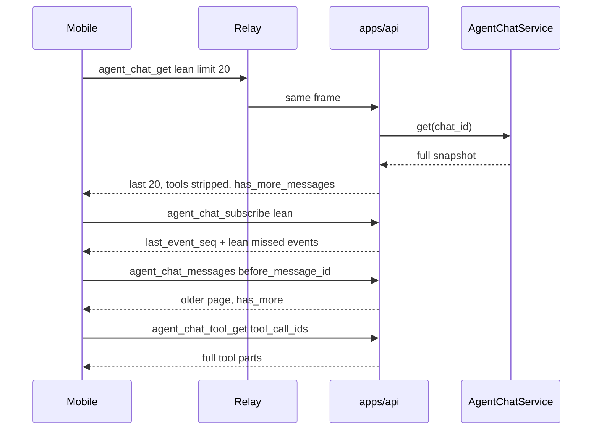

# TECH · QUALITY-031: Mobile Chat message pagination + lazy tool events

> Technical Design · HOW. Mobile Agent Chat first paint is a 20-message window with summarized tool calls; older pages and tool bodies load on demand. Web stays on a full snapshot.

## Spec id

`QUALITY-031` is the next free QUALITY id.

- `origin/main` has QUALITY-001…027, QUALITY-029, QUALITY-030.
- Open PR #354 holds QUALITY-028 (list skeleton + filter-list 20-item pagination). That is **not** chat message pagination.
- Search for `QUALITY-031` on open pull requests returned nothing at selection time.

QUALITY specs may omit BRAINSTORM/PRD. Product goals in this TECH are the contract.

## Scope summary

Addresses:

- **M1** — Opening a Mobile chat loads at most **20 messages** (message count, not turns) over `/ws` through Relay.
- **M2** — Scrolling to the top loads the previous page of 20.
- **M3** — Tool-call parts on that first paint (and live lean events) carry summary fields only. Expanding a tool fetches full params/result and shows Loading until they arrive.
- **M4** — Live new messages still append; EventGate subscribe/backfill stay the sync path.
- **N1** — Web is **not** switched to forced pagination. Omitted request fields keep today’s full snapshot and full tool payloads.

Out of scope: Web virtual-list changes, Relay payload inspection, `agent_chat_backfill` text recovery, QUALITY-028 list pagination.

## Architecture overview

```
Mobile thread
  agent_chat_get { message_limit: 20, include_tool_detail: false }
  agent_chat_subscribe { include_tool_detail: false }
        │
        ▼
apps/api  (page + optional strip per request / per subscriber)
        │
        ▼
crates/core-service  AgentChatService.get() full fold (unchanged on disk)
        │
Relay    opaque forward
```



Touched:

- `crates/core-service/src/service/agent_chat/transcript_view.rs` (new) — page window, strip, collect tools
- `apps/api/src/api/ws/message.rs` — `AgentChatToolGet`
- `apps/api/src/api/ws/message/agent_chat.rs` — request DTOs
- `apps/api/src/api/ws/router/mod.rs` + `router/agent_chat.rs` — handlers, per-conn lean fan-out
- `packages/api-types` — DTOs, `WsContract`, extract catalog
- `packages/api-client/src/agent-chat/fold.ts` — do not clobber full params with lean updates
- `apps/mobile` — thread hydrate, prepend, tool expand Loading
- Web wrappers: **no call-site change**

## Decisions

1. **Extend existing actions** instead of a parallel history RPC. `agent_chat_get` / `agent_chat_messages` / `agent_chat_subscribe` gain optional fields. Defaults = current Web behavior.
2. **New `agent_chat_tool_get`** for expand. Do not overload `agent_chat_backfill` (that is QUALITY-006 text suffixes).
3. **Per-connection lean live events.** The fan-out set is shared by Web and Mobile on the same chat. Subscribe stores `include_tool_detail` per `conn_id`. Full subscribers still get full `turn_snapshot` / `tool_call_*` payloads.
4. **Message cursor is `before_message_id`** (exclusive, fold order). Do not reuse EventGate `after_sequence` — that is revision sync, not transcript windows.
5. **Server still folds the full transcript**, then slices/strips for the wire. Disk layout unchanged. A later store-level window is a follow-up if fold cost dominates.
6. **Page size 20, clamp 1..=100.** Mobile always sends 20. Unknown `before_message_id` → empty page, `has_more: false` (no retry storm).
7. **Duplicate title `agent_chat_get` on the thread screen is removed.** Title/config come from the lean snapshot `meta` already loaded by the thread hook.

## Module-by-module design

### crates/core-service

New `transcript_view.rs`:

- `AGENT_CHAT_MESSAGE_PAGE_DEFAULT = 20`
- `AGENT_CHAT_MESSAGE_PAGE_MAX = 100`
- `AGENT_CHAT_TOOL_GET_MAX = 20`
- `clamp_message_limit(limit) -> usize`
- `page_messages(messages, limit, before_message_id) -> (Vec<FoldedMessage>, has_more)`
- `strip_message_tool_details(messages)` / `strip_event_tool_details(event)` / `strip_agent_tool(tool)`
- `collect_tool_parts(messages, ids) -> Vec<MessagePart>` (request order, skip missing)

Strip keeps identity + collapsed summary:

| Keep                                              | Drop / shrink                                                  |
| ------------------------------------------------- | -------------------------------------------------------------- |
| `tool_call_id`, parent, name, title, kind, status | Full `Diff` contents → `DiffStats` (line counts)               |
| Small params (`path`, `query`, `url`, …)          | `Execute.output`, `FileContent.text`, `WebFetch` markdown/text |
| `Execute.exit_code` with empty output             | `Other` vendor JSON → `null`                                   |
| Search hit path+line                              | Hit snippets; `Subagent.prompt`; `PlanDocument.plan` / phases  |

After serialize, the API injects `detail_omitted: true` on stripped tool JSON so Mobile can fetch. The Rust `AgentTool` struct is **not** given a new field (too many host literals). TS `AgentTool.detail_omitted?` is the wire flag.

### apps/api

**`agent_chat_get`** input becomes `AgentChatGetRequest` (superset of `{ chat_id }`):

```
chat_id: string
message_limit?: u32        // omit = all messages
include_tool_detail?: bool // omit / true = full tools
```

Response: existing `AgentChatSnapshot` plus optional `has_more_messages: true` when the window is not the full history. `false` is omitted so Web JSON stays unchanged.

**`agent_chat_messages`**

```
chat_id
limit?: u32
before_message_id?: string  // exclusive older-than
include_tool_detail?: bool
```

Response `{ messages, has_more }`. No `before` and no `limit` → all messages (today). `before` without `limit` → default 20.

**`agent_chat_subscribe`**

```
chat_id
after_sequence?: u64
include_tool_detail?: bool  // omit / true = full events
```

`agent_chat_subs`: `HashMap<chat_id, HashMap<conn_id, AgentChatSubOpts>>`. Repeat subscribe updates opts. Disconnect / unsubscribe / QUALITY-018 rollback unchanged except `contains` → `contains_key`.

Fan-out and subscribe replay clone+strip per lean connection. Full connections share the original event.

**`agent_chat_tool_get`** (new `WsAction`)

```
input:  { chat_id, tool_call_ids: string[] }  // clamp 1..=20
output: { parts: AgentPart[] }                // full tool_call parts, request order
```

Looks up `get()` snapshot (live overlay included). Missing ids are skipped. Missing chat → NotFound.

### packages/api-types + api-client

Same PR: extract catalog, DTOs, `WsContract` rows.

`mergeToolCallState`: if `incoming.detail_omitted` and existing params/result are complete (`detail_omitted` not true), keep existing params/result and still take status/title/name/kind. Lean live ticks must not wipe an expanded body.

### apps/mobile

Constants: `MOBILE_CHAT_MESSAGE_PAGE_SIZE = 20`.

Hydrate:

1. `agent_chat_get({ chat_id, message_limit: 20, include_tool_detail: false })`
2. EventPump hydrate as today
3. `agent_chat_subscribe({ chat_id, after_sequence: cursor, include_tool_detail: false })`

`MobileWsClient` resync remembers those flags from the last get/subscribe so Relay catch-up does not pull a full snapshot.

Older page: `agent_chat_messages({ chat_id, limit: 20, before_message_id: oldestId, include_tool_detail: false })`. Prepend by id. `FlatList` is not inverted; `onStartReached` + `maintainVisibleContentPosition` when not stuck to the end. In-flight + failure: header spinner / Retry (up to 3 automatic retries, then the header).

Resync merge: snapshot window replaces overlapping ids; local messages not in the window stay as prefix/suffix. Restored full tool bodies are copied onto lean parts with the same `tool_call_id`.

Expand: `ToolCallRow` already collapsed-by-default. If `detail_omitted`, expanding calls `agent_chat_tool_get` and mounts a spinner instead of `ToolBodyView`. Success patches the part. Failure shows Retry on the row. If the tool is still expanded when a lean `completed` arrives, fetch once more.

Expand-store reset keys off **chat id**, not `messages[0].id`, so prepending older history does not collapse open tools.

### apps/web

`wsRequest("agent_chat_get", { chat_id })` unchanged. No `message_limit`, no lean subscribe, no forced paging.

## Data model

No new tables. No jsonl format change.

```ts
export type AgentChatGetRequest = {
  chat_id: string;
  message_limit?: number | null;
  include_tool_detail?: boolean | null;
};

export type AgentChatMessagesRequest = {
  chat_id: string;
  limit?: number | null;
  before_message_id?: string | null;
  include_tool_detail?: boolean | null;
};

export type AgentChatMessagesResponse = {
  messages: AgentMessage[];
  has_more: boolean;
};

export type AgentChatSubscribeRequest = {
  chat_id: string;
  after_sequence?: number | null;
  include_tool_detail?: boolean | null;
};

export type AgentChatToolGetRequest = {
  chat_id: string;
  tool_call_ids: string[];
};

export type AgentChatToolGetResponse = {
  parts: AgentPart[];
};
```

`AgentChatSnapshot.has_more_messages?: boolean` — present only when true.

`AgentTool.detail_omitted?: boolean` — present only on lean wire objects.

## Transport

WebSocket only. Relay does not parse chat payloads.

### Compatibility

| Client           | Request                                | Wire                                               |
| ---------------- | -------------------------------------- | -------------------------------------------------- |
| Web (unchanged)  | `{ chat_id }` get + subscribe          | Full messages, full tools, full events             |
| Mobile           | get/messages/subscribe with lean flags | ≤20 messages, stripped tools, lean events          |
| Old Mobile build | `{ chat_id }` get                      | Full snapshot (same as today) until this app ships |

## Security & permissions

Same chat access as `agent_chat_get`. `tool_call_ids` are looked up only inside that chat. No extra REST.

## Rollout plan

1. core-service page/strip/collect + unit tests.
2. API DTOs, handlers, lean fan-out, `agent_chat_tool_get`.
3. api-types extract + contract + mergeToolCallState.
4. Mobile hydrate, prepend, tool expand Loading.
5. Targeted cargo/bun tests, oxlint/oxfmt on touched TS, clippy on api + core-service.

## Risks & tradeoffs

- **Risk**: Lean `turn_snapshot` plus a later full `tool_get` can race. Merge rule keeps full params when `detail_omitted` incoming hits a complete part.
- **Risk**: First 20 messages that still fit on screen fire `onStartReached`. That is intended fill-the-viewport paging; `has_more: false` stops it.
- **Risk**: Server still folds the whole jsonl per get. Acceptable for this cut; the Relay bytes are the mobile constraint.
- **Tradeoff**: JSON `detail_omitted` injection vs a new `AgentTool` field. Injection avoids churning every host `AgentTool { ... }` literal.
- **Rollback**: Mobile can omit the new fields and get the old full snapshot.

## Dependencies & compatibility

- Builds on QUALITY-006 (part fold), QUALITY-013 (EventGate), QUALITY-018 (subscribe register-before-snapshot).
- Does not block or change QUALITY-028.
- Minimum Atmos: this PR’s Computer. Old clients remain valid.

## Open questions

None. Defaults preserve Web; Mobile is the only caller of the new fields.
