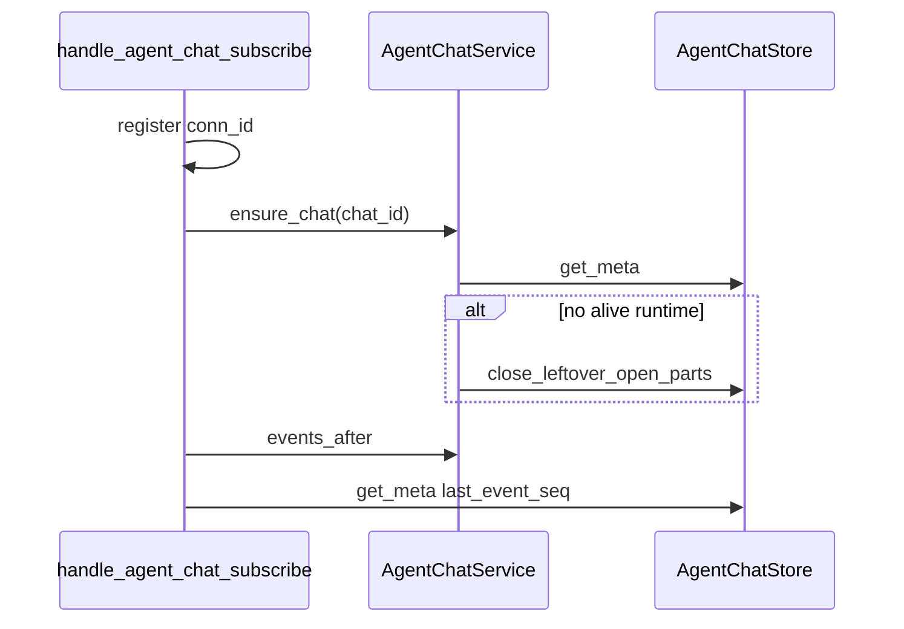

# TECH · QUALITY-033: Agent chat subscribe light existence

> Technical Design · HOW. Stop `handle_agent_chat_subscribe` from folding the whole transcript for an existence check QUALITY-018 no longer needs. No BRAINSTORM or PRD (quality spec).

## Spec id

`QUALITY-033` is the next free QUALITY id.

- `origin/main` has QUALITY-001…032. QUALITY-031 is `0c8662965` (#364).
- Search for `QUALITY-033` on open pull requests and issues returned nothing at selection time.

QUALITY specs may omit BRAINSTORM/PRD. The Musts below are the contract.

## Scope summary

[QUALITY-018](../QUALITY-018_agent-chat-subscribe-race/TECH.md) registers the connection first, then calls `AgentChatService::get` for **existence + leftover-part close**, discards the snapshot, replays `events_after`, and returns `store.get_meta(chat_id).last_event_seq`.

`get` always folds `transcript.jsonl` + `live.jsonl` through `get_snapshot` → `fold_chat_dir`. Long chats exceed the mobile 30s WS request timeout. [QUALITY-031](../QUALITY-031_mobile-chat-pagination-tool-lazy/TECH.md) made lean first paint succeed, so the failure is now a banner `WebSocket request timeout: agent_chat_subscribe` instead of a full-page load failure.

Musts:

- **M1.** Subscribe existence is `get_meta` (missing chat → `NotFound` / same rollback as QUALITY-018). It must not call `get_snapshot` or `fold_chat_dir`.
- **M2.** Leftover-part close stays on the no-live-runtime path, using `close_leftover_open_parts`. That scan is not a fold: it does not build `FoldedTurn` / messages / rewind view / queue.
- **M3.** QUALITY-018 order stays: register → existence/settle → `events_after` → replay → second `get_meta` for `{ last_event_seq }`. Repeat-subscribe rollback is unchanged.
- **M4.** No change to lean fan-out, `include_tool_detail`, Mobile hydrate order, client timeout constants, oxlint `--max-warnings=455`, or wire shape.

Out of scope: paging `agent_chat_get` so it does not full-fold (QUALITY-031 already recorded that as a later store window). Raising the 30s timeout. Client EventGate.

## Quality target

| Item                        | Before                                                                                                 | After                                                                    |
| --------------------------- | ------------------------------------------------------------------------------------------------------ | ------------------------------------------------------------------------ |
| Subscribe existence         | `AgentChatService::get` → leftover close (if detached) + `fold_chat_dir` + flatten; snapshot discarded | `ensure_chat`: `get_meta`, then leftover close only when no live runtime |
| Leftover-part close         | Side effect of `get` when the runtime map has no alive entry                                           | Same condition, without the fold                                         |
| Live runtime                | `get` overlays live state after a full fold                                                            | Skip leftover close (must not truncate `live.jsonl`); no fold            |
| Watermark                   | Second `get_meta` after replay                                                                         | Unchanged                                                                |
| Wire / lean opts / timeouts | `{ last_event_seq }`; QUALITY-031 per-conn lean                                                        | Unchanged                                                                |

## Leftover-part close (verified)

`AgentChatService::get` today:

1. If `runtimes[id].alive`: `get_snapshot` + `overlay_live_state`. **Does not** close leftovers (a live host is still appending `live.jsonl`).
2. Else: `store.close_leftover_open_parts` then `get_snapshot`.

`close_leftover_open_parts` → `settle_live_unlocked` → `leftover_open_text_parts` (scan jsonl for open `TextChunk`s) → append `PartFinished` → truncate `live.jsonl`. It does **not** emit `AgentChatEvent`. Clients see the close on the next snapshot/`get`, not as a live event.

Subscribe does not return messages. The close is still required for QUALITY-018 crash-settle when a client subscribes without a prior `get` (reconnect). QUALITY-031 Mobile hydrate already calls lean `agent_chat_get` first, so leftovers are often already settled; a second close is then a cheaper scan than a second fold.

`close_leftover_open_parts` does not check `meta.json`. Calling it on a missing id can `File::create` `live.jsonl`. Existence **must** be `get_meta` first.

Do not close leftovers while a live runtime is writing `live.jsonl`.

## Architecture overview

```
WsMessageService::handle_agent_chat_subscribe
  register conn_id in agent_chat_subs (QUALITY-018, lean opts QUALITY-031)
  AgentChatService::ensure_chat
      store.get_meta                 // NotFound → rollback if inserted
      if no alive runtime:
          store.close_leftover_open_parts   // not fold_chat_dir
  events_after(after_sequence)
  [cfg(test) pause]
  WsManager::send_to (lean strip per QUALITY-031)
  AgentChatStore::get_meta           // last_event_seq
```



No new crate, table, `WsAction`, or REST route.

## Module-by-module design

### `crates/core-service/src/service/agent_chat/service.rs`

```rust
pub async fn ensure_chat(&self, id: &str) -> Result<()>
```

1. `store.get_meta(id)?`
2. If no alive runtime for `id`, `store.close_leftover_open_parts(id)?`
3. Return `Ok(())`. Do not call `get_snapshot`.

`get()` is unchanged (history / tool_get still fold).

### `crates/core-service/src/service/agent_chat/store.rs`

Optional hidden `fold_chat_dir_calls()` counter incremented from `get_snapshot` / `folded_turns` so tests can prove subscribe does not fold. No jsonl format change.

### `apps/api/src/api/ws/router/agent_chat.rs`

Replace `self.agent_chat().get(&req.chat_id).await` with `ensure_chat`. Keep register-first, `inserted` rollback, lean replay, second `get_meta`.

## Data model / Transport

Unchanged. Response stays `{ "last_event_seq": <u64> }`. `include_tool_detail` still only affects replay/fan-out strip.

## Security & permissions

Unchanged. Subscribe still does not authorize the chat id.

## Rollout plan

1. This spec and the `specs/README.md` row.
2. `ensure_chat` + handler swap. No client change.
3. Server tests: subscribe does not increment fold count; leftover close still materializes `PartFinished` when detached; QUALITY-018 rollback/race tests stay green.

One PR. No feature flag.

## Risks & tradeoffs

- **Risk**: Skipping leftover close on subscribe would leave crashed `live.jsonl` open until the next `get`. Kept the close; dropped only the discarded fold.
- **Risk**: `close_leftover_open_parts` still reads jsonl. That is cheaper than building the message tree, rewind view, and queue, and it is the QUALITY-018 settle. Do not lengthen client timeouts if a huge leftover scan remains slow — that would be a later store-window follow-up, not this PR.
- **Tradeoff**: Hidden fold counter on the store vs an env-var panic hook. Counter is deterministic in `cargo test -p api`.
- **If this breaks in production**: restore `get()` in the handler. The timeout returns; QUALITY-018 ordering is unchanged.

## Dependencies & compatibility

- Depends on QUALITY-018 (register-first, rollback, watermark after replay).
- Follow-up to QUALITY-031 (lean first paint made this timeout visible).
- No minimum client version. Wire unchanged.
- `package.json` `lint` stays `oxlint --max-warnings=455`.

## Open questions

None. Leftover close stays; fold does not.
