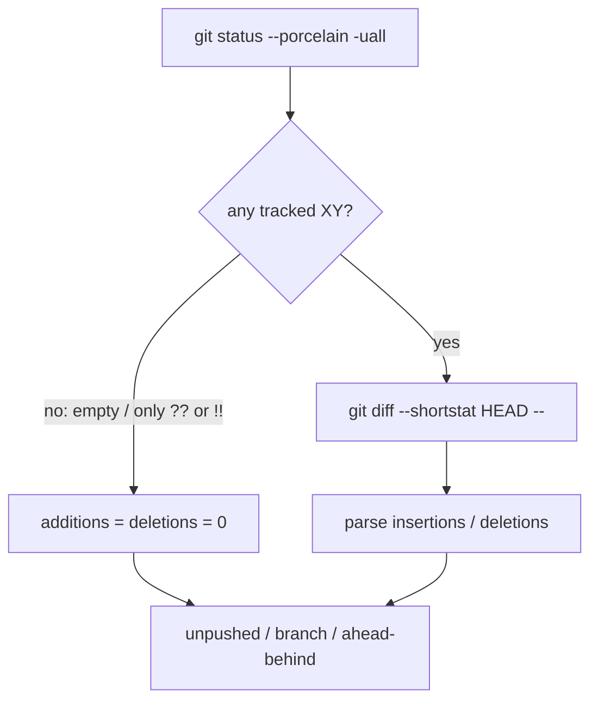

# TECH · QUALITY-034: Git status shortstat cost

> Technical Design · HOW. Cut extra `git diff --shortstat` processes in `GitEngine::get_git_status` without changing workspace-list +/- / dirty / branch display. Quality spec. No BRAINSTORM or PRD.

## Spec id

`QUALITY-034` is the next free QUALITY id.

- `origin/main` has QUALITY-001…033. QUALITY-033 is `agent-chat-subscribe-light-existence`.
- Search for `QUALITY-034` in this repo's code and open PRs returned nothing at selection time.

QUALITY specs may omit BRAINSTORM/PRD. The Musts below are the contract.

## Scope summary

Workspace list git status (`git_get_status` / `git_get_status_batch`) pays for **two** extra git processes per path after porcelain: `git diff --shortstat` (unstaged vs index) and `git diff --cached --shortstat` (index vs HEAD). Those counts are summed into `GitStatus.additions` / `deletions`.

Verified:

- Mobile `use-workspace-list-git-status` / `workspace-list-git-status` call `git_get_status_batch` once. They do **not** re-run shortstat. Duplication is per-path on the server.
- Web `gitApi.getStatuses` is the same batch action. Client path-collect (expanded project-group / filtered recent rows) stays as-is this PR.
- Untracked files are already excluded from +/- (`types.rs` comments). Porcelain `??` still increments `uncommitted_count`.

Musts:

- **M1.** Dirty tracked paths run **one** shortstat: `git diff --shortstat HEAD --` (working tree vs HEAD). Do not keep the unstaged + cached pair.
- **M2.** When porcelain has no tracked line that can contribute to +/- (`??` / `!!` only, or empty), skip shortstat. `additions` and `deletions` are 0.
- **M3.** Porcelain dirty, untracked, merge-conflict, branch, ahead/behind, and unpushed fields stay the same as today.
- **M4.** For the common states the list shows (clean, untracked-only, staged-only, unstaged-only, additive staged+unstaged on different lines, staged new file), +/- matches today's staged+unstaged sum. Untracked still contributes 0 to +/-.
- **M5.** No workspace UI refactor, no oxlint `--max-warnings` above 455, no new `WsAction` / REST route.

Out of scope: changing +/- so typical repo states show different numbers; visible-window / `staleTime` client batching; simulator / Metro; merging this PR.

## Quality target

| Item                         | Before                                                               | After                                                                     |
| ---------------------------- | -------------------------------------------------------------------- | ------------------------------------------------------------------------- |
| Shortstat per dirty path     | 2 (`git diff --shortstat` + `git diff --cached --shortstat`)         | 1 (`git diff --shortstat HEAD --`)                                        |
| Shortstat per clean path     | 2 (both empty)                                                       | 0                                                                         |
| Shortstat per untracked-only | 2 (both empty; untracked is not in shortstat)                        | 0                                                                         |
| `additions` / `deletions`    | Sum of unstaged-vs-index and index-vs-HEAD                           | Net tracked vs HEAD (equals that sum when hunks do not overlap or cancel) |
| Porcelain / branch / ahead   | Unchanged                                                            | Unchanged                                                                 |
| Client path-collect          | Mobile expanded project-group paths; web filtered recent / repo rows | Unchanged this PR                                                         |

Process-count claim (engine `get_git_status` shortstat subprocesses only):

- **Before:** 2 per path, always, after porcelain.
- **After:** 0 when porcelain has no tracked diff; 1 when it does.
- A list of N mostly-clean worktrees drops `2N` shortstat processes. Dirty rows drop 2 → 1.

## Architecture overview

```
git_get_status / git_get_status_batch
  WsMessageService::get_git_status
    GitEngine::get_git_status
      git status --porcelain -uall
      if porcelain_has_tracked_diff:
          git diff --shortstat HEAD --     # once
      else:
          additions = deletions = 0
      unpushed / upstream behind / default-branch divergence
      current_branch (already computed here; WS reuses it)
    git config --get remote.origin.url     # residual, WS only
```



No new crate, table, `WsAction`, or REST route. Wire stays `GitStatusResponse`.

## Decision: HEAD shortstat, not the two-call sum

`git diff --shortstat HEAD --` is the working tree versus HEAD. That is staged plus unstaged tracked content in **one** combined diff.

Empirically vs today's sum:

| Repo state                         | Two-call sum | `HEAD` shortstat | Match? |
| ---------------------------------- | ------------ | ---------------- | ------ |
| Clean                              | 0 / 0        | 0 / 0            | yes    |
| Untracked only                     | 0 / 0        | 0 / 0            | yes    |
| Unstaged only                      | unstaged     | same             | yes    |
| Staged only                        | cached       | same             | yes    |
| Both, extra lines (no overlap)     | a+b          | a+b              | yes    |
| Staged new file                    | cached       | same             | yes    |
| Same-line staged then further edit | inflated     | net vs HEAD      | no     |
| Stage then revert worktree to HEAD | inflated     | 0                | no     |

M4 requires parity for the first six. The last two are rare; HEAD is the number a list +/- actually means (net uncommitted tracked lines). TECH records them as accepted residuals rather than keeping a second git process to preserve double-counting.

Do **not** use `uncommitted_count == 0` alone as the skip. That misses untracked-only rows, which still paid two empty shortstats.

## Module-by-module design

### `crates/core-engine/src/git/refs.rs`

Replace `diff_shortstat(repo, cached: bool)` with:

```rust
fn porcelain_has_tracked_diff(status_stdout: &str) -> bool
fn diff_shortstat_vs_head(repo_path: &Path) -> (u32, u32)
```

`porcelain_has_tracked_diff` is true when any non-empty porcelain line's first two bytes are not `??` and not `!!`.

`diff_shortstat_vs_head` runs `git diff --shortstat HEAD --` through existing `try_run_git`. Failure or empty stdout → `(0, 0)`. Reuse `parse_diff_shortstat`.

`get_git_status`:

1. Porcelain as today (`status --porcelain -uall`).
2. If `porcelain_has_tracked_diff`, one HEAD shortstat; else `(0, 0)`.
3. Unpushed / behind / default-branch divergence unchanged.
4. Put the already-fetched `current_branch` on `GitStatus` so the WS mapper does not call `get_current_branch` again.

Test-only thread-local shortstat call counter (same idea as blame's cache-hit cell): increment only inside `diff_shortstat_vs_head`. Tests reset and read it to prove 0 vs 1.

### `crates/core-engine/src/git/types.rs`

Keep `additions` / `deletions`. Tighten the comments to "tracked staged plus unstaged versus HEAD; untracked not included."

Add `current_branch: Option<String>` for the reuse in M3 (branch display). Not a wire change by itself; WS still maps onto `GitStatusResponse.current_branch`.

### `apps/api/src/api/ws/router/git.rs`

`WsMessageService::get_git_status` uses `status.current_branch` instead of a second `git_engine.get_current_branch`. Leave `get_remote_url` as-is (needed for `github_owner` / `github_repo`; not already computed in the engine).

### Clients

No change. Mobile still one `git_get_status_batch`. Web path-collect and `staleTime` stay. Optional later: visible-window batching — not this PR.

### `packages/api-types/src/ws/dto/git.ts`

Comment-only: same "versus HEAD" clarification. No shape change.

## Data model / Transport

Unchanged wire:

```ts
GitStatusResponse.additions?: number  // tracked vs HEAD
GitStatusResponse.deletions?: number
GitStatusResponse.uncommitted_count: number  // porcelain lines, including ??
GitStatusResponse.current_branch: string | null
```

No new WebSocket message. No REST.

## Security & permissions

Unchanged. Still runs git in the expanded workspace path. No new args that accept caller-controlled refs beyond existing `HEAD`.

## Rollout plan

1. This spec and the `specs/README.md` QUALITY-034 row.
2. Engine: skip + one HEAD shortstat + `current_branch` on `GitStatus`. WS mapper reuse.
3. Rust tests for parse, porcelain skip, and `get_git_status` parity / call counts.
4. Draft PR against `main`. Do not merge.

One PR. No feature flag.

## Risks & tradeoffs

- **Risk**: same-line overlap or canceling staged+unstaged used to inflate +/-. HEAD reports net. Accept; typical list states match. Rollback is restoring the two `diff_shortstat` calls.
- **Risk**: `git diff --shortstat HEAD --` fails on a repo with no commits. `try_run_git` already maps that to `(0, 0)`, same as a failed cached/unstaged shortstat.
- **Tradeoff**: skip uses porcelain XY, not `uncommitted_count == 0`, so untracked-only rows skip too.
- **Tradeoff**: do not fold `get_remote_url` into the engine this PR. One extra git process per path remains at the WS layer.
- **If this breaks list +/-**: revert `refs.rs` shortstat selection only. Porcelain and branch code stay.

## Dependencies & compatibility

- Follow-up to QUALITY-026 (mobile project-group `git_get_status_batch`) and Eng Manager audit follow-up #5 P2.
- No minimum client version. Wire unchanged.
- `package.json` `lint` stays `oxlint --max-warnings=455`.

## Residual cost (not this PR)

- WS still runs `git config --get remote.origin.url` per path after the engine.
- Engine still runs porcelain, two `rev-list` unpushed/behind probes, default-branch lookup, and optional divergence `rev-list`.
- Clients may still batch every expanded/filtered path, not only the visible window.
- `get_changed_files` file-level numstat is a different surface and is unchanged.

## Open questions

None. HEAD shortstat plus porcelain skip is the change.
