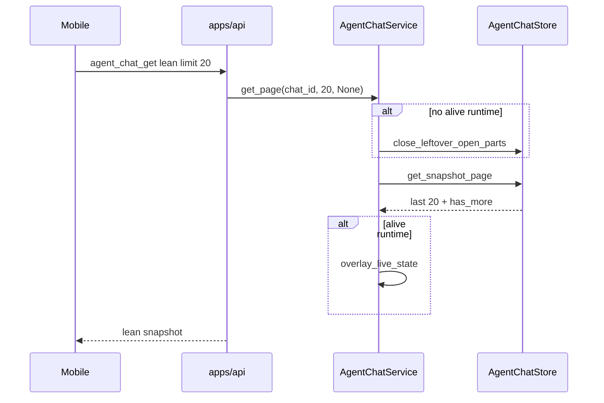

# TECH · QUALITY-034: Lean `agent_chat_get` O(page)

> Technical Design · HOW. Stop lean `agent_chat_get` / paged `agent_chat_messages` from full-folding `transcript.jsonl` then slicing. No BRAINSTORM or PRD (quality spec).

## Spec id

`QUALITY-034` is the next free QUALITY id after QUALITY-033.

- `origin/main` has QUALITY-001…033. QUALITY-031 is `0c8662965` (#364). QUALITY-033 is `45ab13cb6` (#366).
- Search for `QUALITY-034` on open pull requests returned nothing at selection time.

QUALITY specs may omit BRAINSTORM/PRD. The Musts below are the contract.

## Scope summary

[QUALITY-031](../QUALITY-031_mobile-chat-pagination-tool-lazy/TECH.md) slices the **already-folded** snapshot to 20 messages and strips tools. The store still runs `get_snapshot` → `fold_chat_dir` over the whole `transcript.jsonl` + `live.jsonl`. Long chats pay O(full history) before the page exists.

Musts:

- **M1.** Lean `agent_chat_get` with `message_limit` (Mobile default 20) does not call `fold_chat_dir` / `get_snapshot` on the common path. Fold cost is **O(page)** (envelopes in the window plus a small older margin), not O(full transcript).
- **M2.** Wire/product semantics unchanged: last N messages in fold order, `has_more_messages` when older rows exist, lean tool strip, omitted `message_limit` still full snapshot (Web).
- **M3.** Paged `agent_chat_messages` (`limit` and/or `before_message_id`) uses the same windowed store path and must not re-fold the entire history for the page.
- **M4.** No client WS timeout change. No default page size / pagination rule change. No regression of QUALITY-031 strip / `agent_chat_tool_get` / QUALITY-033 subscribe (`ensure_chat`, no fold).

Out of scope: raising the 30s timeout; durable on-disk fold cache; changing Mobile first-paint size from 20; oxlint `--max-warnings=455`.

## Quality target

| Item                         | Before (QUALITY-031)                                    | After                                                 |
| ---------------------------- | ------------------------------------------------------- | ----------------------------------------------------- |
| Lean get `message_limit: 20` | `get()` full-fold, then `page_messages`                 | Reverse-read jsonl, fold the tail window, page, strip |
| Older page                   | Same full-fold, then `page_messages(before_message_id)` | Reverse-read until the cursor, fold only that window  |
| Web full get (no limit)      | `fold_chat_dir`                                         | Unchanged                                             |
| `agent_chat_tool_get`        | `get()` full snapshot, then `collect_tool_parts`        | Unchanged (must still find tools anywhere in history) |
| Subscribe                    | QUALITY-033 `ensure_chat`                               | Unchanged                                             |

## Decision: reverse page-read, not a fold cache

Two hypotheses:

1. **Durable in-memory / on-disk fold cache**, invalidated on append / rewind / leftover settle.
2. **Reverse-read `transcript.jsonl` + full `live.jsonl`**, fold only the envelopes needed for the requested window.

Chosen **(2)**. A cache still makes a cold first paint O(full) — that is the Mobile timeout. This tree is append-only jsonl with no snapshot file; a cache would add invalidation surface (append, rewind_view, leftover `PartFinished`, live overlay) without helping the first lean get.

`fold_envelopes` is a forward state machine, so the window must start on a turn boundary (`TurnStarted`). Collect complete turns from the logical end until flatten + `page_messages` can satisfy `limit` / `before_message_id`, plus a small older margin so cross-turn assistant merge at the window edge matches a full fold.

```
logical end
  = rewind_view.until_turn_id (inclusive) when set
  = EOF of transcript.jsonl + live.jsonl otherwise
```

Live events merge only when their `turn_id` is in the collected window (tail page: yes; older page: usually no).

## Architecture overview

```
Mobile lean get
  agent_chat_get { message_limit: 20, include_tool_detail: false }
        │
        ▼
apps/api  handle_agent_chat_get
        │  message_limit set → AgentChatService::get_page
        │  omitted → AgentChatService::get (full fold, Web)
        ▼
crates/core-service
  leftover close if detached (QUALITY-035)
  AgentChatStore::get_snapshot_page
      reverse-read transcript + read live
      fold_envelopes(window)     // not fold_chat_dir
      apply_rewind_view
      flatten + page_messages
        │
        ▼
apps/api  strip / has_more_messages  (QUALITY-031 wire)
```



No new crate, table, `WsAction`, or REST route.

## Module-by-module design

### `crates/core-service/src/service/agent_chat/transcript_page.rs` (new)

Window fold used only when a page is requested.

- Reverse jsonl reader (block reads from EOF, split on `\n`).
- `fold_message_page(dir, rewind, limit, before_message_id) -> MessagePage`
- Collect turns from the logical end until:
  - `before_message_id` is None and flattened length ≥ `limit + 1` (extra row proves `has_more`), or file start; or
  - `before_message_id` is Some, that id is in the flattened list, and there are `limit` older messages or file start; or
  - unknown cursor after reaching start → empty page, `has_more: false` (QUALITY-031 S12).
- Older-margin: keep collecting while the first flattened message would be an assistant that a previous turn could merge into (or a fixed +2 message margin).
- Fold **only** collected envelopes via existing `fold_envelopes`. Do not increment `fold_chat_dir_calls`.
- Hidden counters on the store (test-only, same style as QUALITY-033):
  - `paged_fold_envelopes()` — envelopes passed to `fold_envelopes`
  - `paged_transcript_envelopes_read()` — transcript lines parsed (includes skip-to-cursor)

### `crates/core-service/src/service/agent_chat/store.rs`

```rust
pub fn get_snapshot_page(
    &self,
    id: &str,
    limit: usize,
    before_message_id: Option<&str>,
) -> Result<(AgentChatSnapshot, bool)>
```

Same lock / `get_meta` / queue / pending-session-op as `get_snapshot`. Pending permission comes from the **windowed** envelopes (tail page includes the latest `Permission`). Does not call `fold_chat_dir`.

`get_snapshot` stays the full-fold path.

### `crates/core-service/src/service/agent_chat/service.rs`

```rust
pub async fn get_page(
    &self,
    id: &str,
    limit: usize,
    before_message_id: Option<&str>,
) -> Result<(AgentChatSnapshot, bool)>
```

Same live-runtime branch as `get()`: overlay when alive; leftover close when detached; then `get_snapshot_page`. `get()` unchanged.

### `apps/api/src/api/ws/router/agent_chat.rs`

- `handle_agent_chat_get`: `message_limit` present → `get_page` + existing strip / `has_more_messages`. Omitted → `get()`.
- `handle_agent_chat_messages`: paged (`limit` or `before_message_id`) → `get_page`. Neither → `get()` (today’s all-messages response).
- `handle_agent_chat_tool_get`: still `get()` so expand works for tools not in the current page.
- Subscribe: still `ensure_chat`.

## Data model / Transport

Unchanged QUALITY-031 wire:

```
agent_chat_get { chat_id, message_limit?, include_tool_detail? }
→ AgentChatSnapshot + has_more_messages?

agent_chat_messages { chat_id, limit?, before_message_id?, include_tool_detail? }
→ { messages, has_more? }
```

Page size clamp 1..=100 unchanged. Mobile still sends 20.

## Security & permissions

Unchanged. Same chat id existence as `get()`.

## Rollout plan

1. This spec, QUALITY-035, `specs/README.md` rows.
2. `transcript_page.rs` + `get_snapshot_page` / `get_page`.
3. API handlers switch paged get/messages to `get_page`.
4. Tests: large transcript lean get does not increment `fold_chat_dir_calls`; folded envelope count is O(page); ids match full-fold slice; older page same; Web full get still folds.

One PR with QUALITY-035. No feature flag.

## Risks & tradeoffs

- **Risk**: Window fold can disagree with a full fold if the window starts mid-assistant-merge. Mitigation: turn-boundary start + older margin; tests compare ids to `page_messages(full, limit, before)`.
- **Risk**: Unknown `before_message_id` reverse-scans to file start (then empty page). Same QUALITY-031 contract; Mobile only sends ids it already loaded. Do not full-fold that miss.
- **Risk**: Deep older pages still **read** from EOF down to the cursor (O(distance)), but **fold** only the window. That is cheaper than `fold_chat_dir` and matches “when feasible”.
- **Tradeoff**: `tool_get` keeps a full fold so expand stays correct for any `tool_call_id`. Not the Mobile first-paint path.
- **If this breaks in production**: handlers can call `get()` again. Wire stays QUALITY-031.

## Dependencies & compatibility

- Depends on QUALITY-031 (page/strip wire) and QUALITY-033 (subscribe must not fold).
- QUALITY-035 leftover short-circuit is the sibling on the same PR; `get_page` still calls leftover close when detached.
- No minimum client version. Wire unchanged.
- `package.json` `lint` stays `oxlint --max-warnings=455`.

## Open questions

None. Reverse page-read is the store approach; fold cache is rejected for cold first paint.
