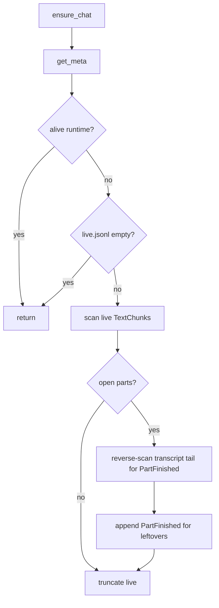

# TECH · QUALITY-035: `ensure_chat` leftover close short-circuit / tail scan

> Technical Design · HOW. Stop `close_leftover_open_parts` from scanning all of `transcript.jsonl` when live is empty or settle can be bounded. No BRAINSTORM or PRD (quality spec).

## Spec id

`QUALITY-035` is the next free QUALITY id after QUALITY-034.

- `origin/main` has QUALITY-001…033. QUALITY-033 is `45ab13cb6` (#366).
- Search for `QUALITY-035` on open pull requests returned nothing at selection time.

QUALITY specs may omit BRAINSTORM/PRD. The Musts below are the contract.

## Scope summary

[QUALITY-033](../QUALITY-033_agent-chat-subscribe-light-existence/TECH.md) moved subscribe from discarded `get()` / `fold_chat_dir` to `ensure_chat` = `get_meta` + `close_leftover_open_parts`. That leftover path still runs `leftover_open_text_parts(transcript, live)`, which **line-scans both files**. After a crash-free chat, `live.jsonl` is empty, but subscribe still reads the whole historical transcript looking for open `TextChunk`s.

Musts:

- **M1.** If live is empty / missing / nothing to settle → **short-circuit**: do not open or scan `transcript.jsonl`.
- **M2.** If settle is needed → scan **live** and/or a **tail window** of transcript, not the whole historical `transcript.jsonl`.
- **M3.** QUALITY-033/018 semantics stay: `get_meta` first; skip leftover close while an alive runtime exists; `PartFinished` still materializes when detached leftovers exist; second `ensure_chat` is idempotent (no duplicate `PartFinished`).
- **M4.** Subscribe must still not call `fold_chat_dir` / `get_snapshot`. No wire change, no timeout change, no oxlint cap change.

Out of scope: emitting leftover `PartFinished` as a live `AgentChatEvent`; lengthening client timeouts; paging `agent_chat_get` (QUALITY-034 on the same PR).

## Quality target

| Item                 | Before (QUALITY-033)                                      | After                                                                     |
| -------------------- | --------------------------------------------------------- | ------------------------------------------------------------------------- |
| Empty live           | Scan all `transcript.jsonl` + `live.jsonl`, then truncate | Return immediately; transcript unread                                     |
| Live has open chunks | Scan both files fully                                     | Scan live; reverse-scan a transcript **tail** for matching `PartFinished` |
| Alive runtime        | Skip leftover close                                       | Unchanged                                                                 |
| Fold                 | Not used on subscribe                                     | Still not used                                                            |

## Why a tail, not “live only”

`append_record_unlocked` writes `TextChunk` to `live.jsonl` and other events to `transcript.jsonl`. Crash-settle leftovers therefore live in `live.jsonl`.

Transcript is still required for **one** race QUALITY-033 already covers: crash after `PartFinished` is appended but before `live.jsonl` is truncated. A live-only scan would append a second `PartFinished`. Those `PartFinished` lines sit at the **end** of transcript, so a reverse tail is enough. Do not replay historical `TextChunk`s from transcript (the writer does not put them there).

Tail bound: `LEFTOVER_TRANSCRIPT_TAIL_MAX = 64` envelopes from EOF (or file start, whichever is first). Tests with hundreds of historical turns must show transcript envelopes read ≤ 64.

## Architecture overview

```
ensure_chat
  get_meta                         // QUALITY-033
  if alive runtime: return
  close_leftover_open_parts
      if live missing or 0 bytes: return          // M1, no transcript
      scan live for open TextChunks
      if open parts:
          reverse-scan transcript tail for PartFinished of those part_ids
      append PartFinished for remaining open parts
      truncate live.jsonl
```



No new crate, table, `WsAction`, or REST route.

## Module-by-module design

### `crates/core-service/src/service/agent_chat/store.rs`

`close_leftover_open_parts` / `settle_live_unlocked`:

1. If `live.jsonl` does not exist or `metadata.len() == 0` → `Ok(())` without touching transcript.
2. Else `leftover_open_text_parts` becomes:
   - `scan_leftover_jsonl(live)` only for `TextChunk` / `PartFinished`.
   - If `open` is empty → no transcript scan (still truncate live: leftover file may be whitespace or already-finished chunks).
   - If `open` is non-empty → `for_each_jsonl_envelope_reverse(transcript)` up to `LEFTOVER_TRANSCRIPT_TAIL_MAX`, applying only `PartFinished` (remove those `part_id`s from `open`). Stop early when `open` is empty.
3. Existing `materialize_leftovers_unlocked` + `truncate_live_unlocked` for whatever remains.

Hidden counters (test-only):

- `leftover_transcript_envelopes_read()`
- `leftover_live_envelopes_read()`

`fold_chat_dir_calls` stays 0 on this path.

### `crates/core-service/src/service/agent_chat/service.rs`

`ensure_chat` control flow unchanged: `get_meta`, skip close if alive, else `close_leftover_open_parts`. `get()` / `get_page()` still call leftover close when detached — they inherit the cheap path.

### `apps/api`

No handler change. Subscribe already uses `ensure_chat`.

## Data model / Transport

Unchanged. Subscribe response stays `{ last_event_seq }`.

## Security & permissions

Unchanged. Existence is still `get_meta` first so a missing id cannot `File::create` `live.jsonl`.

## Rollout plan

1. Specs + README rows (with QUALITY-034).
2. Short-circuit + reverse tail in `leftover_open_text_parts` / `settle_live_unlocked`.
3. Tests: empty live does not increment transcript leftover counter; large history + live leftover still writes one `PartFinished` and transcript reads stay ≤ tail max; QUALITY-033 fold tests stay green.

One PR with QUALITY-034. No feature flag.

## Risks & tradeoffs

- **Risk**: Skipping transcript `TextChunk`s would miss leftovers that were historically written to transcript. Current writer never does that; `get()` fold still shows those parts if they exist. Accepted.
- **Risk**: Tail 64 might miss a `PartFinished` buried under a huge post-crash transcript append while live was not truncated. That is not the QUALITY-018 race (PartFinished is the last transcript line). Bound is documented; raise only with a test.
- **Tradeoff**: Truncate live when live has bytes but no open parts (already-finished race) vs leaving the file. Truncate keeps the QUALITY-033 empty-live invariant.
- **If this breaks in production**: restore a full `leftover_open_text_parts(transcript, live)` scan. Subscribe still will not fold.

## Dependencies & compatibility

- Depends on QUALITY-033 (`ensure_chat`, fold counter) and QUALITY-018 (register-first, leftover settle).
- Same PR as QUALITY-034. Neither changes the other’s wire.
- No minimum client version.
- `package.json` `lint` stays `oxlint --max-warnings=455`.

## Open questions

None. Empty live short-circuits; settle uses live + transcript tail.
